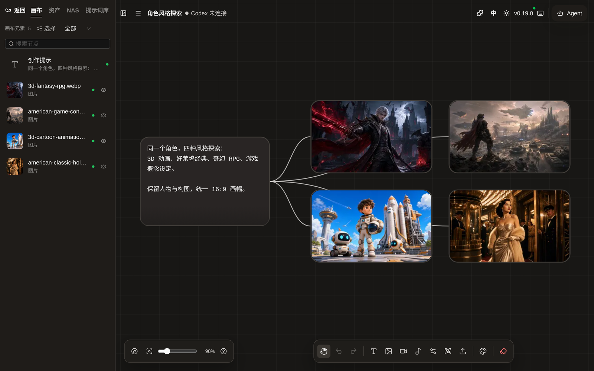
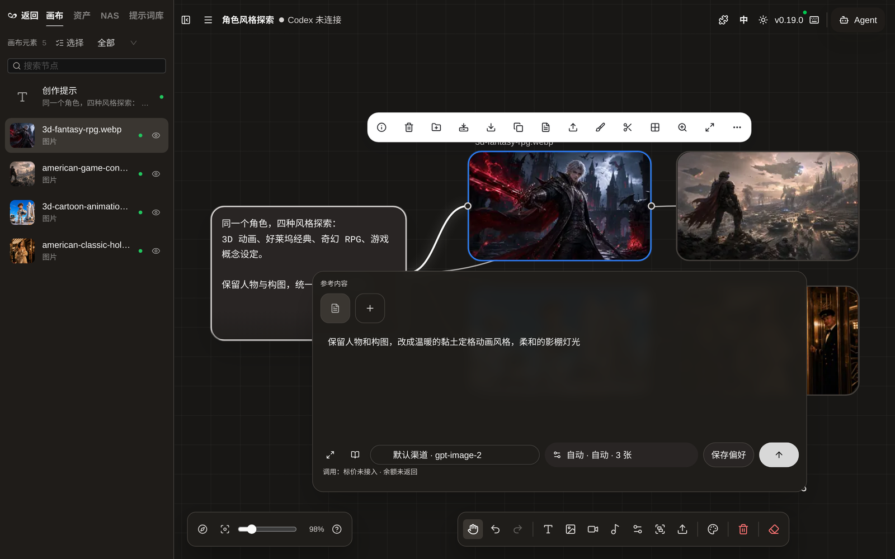
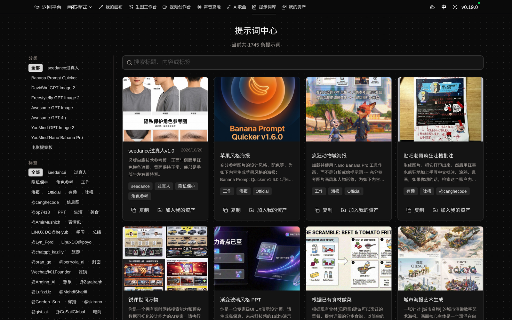

<div align="center">


# sig-dream · sig Canvas

**An open-source, zero-database, ready-to-run local-first AI infinite canvas & creative video studio**

Chain AI image generation, multi-reference editing, video generation, 1,700+ open-source prompts, and Canvas Agent on one infinite canvas — with built-in **Script**, **Replication**, and **Replacement** studios.  
No PostgreSQL, no login server — download the desktop app or portable bundle, add your API key, and start creating in 30 seconds.

[](README.md)
[](README.en.md)
[](README.ja.md)
[](README.ko.md)

[](https://github.com/ChenShuo2004/sig-dream/releases/latest)
[](https://github.com/ChenShuo2004/sig-dream/stargazers)
[](LICENSE)
[](https://x.com/ChenshuoAI)

[Download & Quick Start](#download--quick-start) · [Workspaces](#workspaces) · [Preview](#preview) · [Providers](#supported-models--providers) · [Enterprise (Closed-Source)](#enterprise-edition-closed-source) · [FAQ](#faq)

</div>

<br/>



## Why sig-dream?

- **True out-of-the-box setup**: No PostgreSQL, Redis, or account server. Ships as **native macOS / Windows / Linux desktop installers**, a **zero-install Web Portable bundle**, and a **one-command Docker Compose setup**.
- **End-to-end creative studio**: Goes beyond a node canvas with built-in **Script, Replication, and Replacement studios**, **1,700+ curated prompts**, and **Canvas Agent**.
- **Local-first & private**: Projects, studio documents, local assets, and API keys stay in local IndexedDB / LocalStorage with JSON export/import and optional WebDAV sync. A zero-dependency local CORS proxy ([`server/proxy.mjs`](server/proxy.mjs)) handles providers that block direct browser calls.

---

## Download & Quick Start

### Option 1: Native Desktop App (Recommended · No Node.js Required)

Download the installer for your OS from [**GitHub Releases (Latest)**](https://github.com/ChenShuo2004/sig-dream/releases/latest):

| Platform | Download | Notes |
| --- | --- | --- |
| **macOS (Apple Silicon M1–M4)** | `sig-dream-*-mac-arm64.dmg` | Drag to Applications and launch — built-in local server & CORS proxy |
| **macOS (Intel)** | `sig-dream-*-mac-x64.dmg` | Same as above |
| **Windows (x64)** | `sig-dream-*-win-x64-setup.exe` / `.zip` | Installer or portable zip archive |
| **Linux (x64)** | `sig-dream-*-linux-x64.AppImage` / `.deb` | Standalone desktop package |

> [!TIP]
> Community installers are unsigned. On first launch:
> - **macOS**: Right-click → Open, or run `xattr -cr /Applications/sig-dream.app`
> - **Windows**: Click **More info → Run anyway** in SmartScreen

### Option 2: Web Portable Bundle (No `npm install` · Requires Node.js 20+)

Download `sig-dream-*-web-portable.zip` (~2.7 MB) from [**Releases**](https://github.com/ChenShuo2004/sig-dream/releases/latest), unzip, and run:

- **macOS**: Double-click `启动-macOS.command`
- **Windows**: Double-click `启动-Windows.bat`
- **Linux / Terminal**: Run `./start.sh`

### Option 3: Docker Compose

```bash
git clone https://github.com/ChenShuo2004/sig-dream.git
cd sig-dream
docker compose up -d
```

Then open [http://localhost:3000](http://localhost:3000).

### Option 4: Run from Source (Node.js 20+)

```bash
git clone https://github.com/ChenShuo2004/sig-dream.git
cd sig-dream
npm install
npm run dev
```

For production builds:

```bash
npm run build
npm run start:open
```

---

## Workspaces

| Workspace | Route | What it does |
| --- | --- | --- |
| **Infinite Canvas** | `/canvas` | Connect image, video, and text nodes; group references, mask editing, and Canvas Agent orchestration. |
| **Script Studio** | `/studio/script` | Turn scripts into consistent character, scene, prop sheets, and episode storyboards. |
| **Replication Studio** | `/studio/replication` | Break down reference videos into shot-by-shot prompts and regenerate individual segments. |
| **Replacement Studio** | `/studio/replacement` | Swap subjects or objects in images and videos across supported providers. |
| **Image & Video** | `/image` · `/video` | Dedicated generation views with first/last-frame & multi-reference modes and automatic task resumption. |
| **Prompt Library** | `/prompts` | Browse and filter 1,700+ open-source prompts; copy or save directly to local assets. |
| **Local Assets** | `/assets` | Organize reusable images, videos, and text snippets locally in your browser. |

---

## Preview

### Select Any Image Node to Edit



### Script Studio


### Built-in 1,700+ Prompt Library



---

## Supported Models & Providers

Click the top-right **⚙️ Settings** icon (or **Configure Providers** on the home screen) to add any provider (Base URL + API Key):

- **Standard APIs**: OpenAI-compatible endpoints, Google Gemini, DeepSeek, OpenRouter, etc.
- **Video & Workflow Providers**: Volcengine Ark (Seedance 2.0), RunningHub (ComfyUI workflows & video editing), MiniMax H3, and compatible relays.
- **Built-in CORS Proxy**: Dev mode, production server, Web Portable, and Desktop builds all bundle [`server/proxy.mjs`](server/proxy.mjs) with zero external dependencies.

---

## Enterprise Edition (Closed-Source)

> [!IMPORTANT]
> **The Enterprise Edition is closed-source and not open-sourced.** This repository contains the MIT-licensed, zero-database Community Edition for local single-user creation. The LAN NAS asset hub, drag-to-NLE team desktop, RBAC permissions, and voice/cover studio shown below belong to the commercial Enterprise Edition.

**From Script to Final Cut. All on One Canvas.**<br/>
Infinite Canvas × LAN Asset Library × Cross-Platform Team Desktop


### Community Edition vs. Enterprise Edition

| Feature | Community Edition (This Repo · MIT) | Enterprise Edition (Closed-Source) |
| --- | --- | --- |
| License | MIT open source, ready-to-run locally | Commercial closed-source license (source not public) |
| Canvas & Studios | Infinite canvas, image/video gen, 1,700+ prompts, Script/Replication/Replacement studios | Everything in Community + shared team canvases & full-pipeline production orchestration |
| Distribution & Desktop | Web Portable, Docker, standalone macOS / Windows / Linux desktop app | Team desktop client with LAN NAS library & direct drag-to-NLE editing |
| LAN Asset Hub & NAS | Local IndexedDB storage + JSON / WebDAV backup | PostgreSQL metadata + LAN file machine (NAS direct transfer, auto thumbnails & H.264 previews; originals stay on LAN) |
| Permissions & Audit | No login required (single user) | Dual isolated libraries, 4 roles / 30 granular permissions, full operation audit logs |
| Voice & Cover Studio | — | Local GPU inference (Seed-VC zero-shot timbre conversion + SVS lyric-rewrite cover & A/B compare) |
| Deployment & Support | GitHub Issues community | Private on-premise LAN deployment, multi-node setup & dedicated commercial support |

For full-HD demos, private LAN deployment, or commercial licensing, reach out to [@ChenshuoAI](https://x.com/ChenshuoAI) on X.

---

## FAQ

<details>
<summary><b>Where are my API keys and projects stored?</b></summary>

Everything is stored locally in IndexedDB / LocalStorage. Nothing is sent to any tracking or third-party account server. The built-in `server/proxy.mjs` runs locally only to forward CORS-restricted API requests using your own key.

</details>

<details>
<summary><b>Does the desktop app keep my data after restarting?</b></summary>

Yes. The desktop app binds a stable loopback origin (`http://127.0.0.1:28430`) so IndexedDB projects, assets, and API keys persist cleanly across restarts.

</details>

<details>
<summary><b>Should I upgrade from v0.2.0?</b></summary>

Yes. `v0.2.0` was an early build coupled to an older backend architecture. Starting from `v0.3.0`, the open-source edition is completely zero-database and local-first out of the box.

</details>

---

## Credits & License

- Built on [basketikun/infinite-canvas](https://github.com/basketikun/infinite-canvas) (MIT License), extended with Script / Replication / Replacement studios, multi-provider video adapters, and out-of-the-box desktop/portable packaging. Original license preserved at [LICENSE.upstream-infinite-canvas](LICENSE.upstream-infinite-canvas).
- Licensed under the [MIT License](LICENSE).

<div align="center">

[](https://star-history.com/#ChenShuo2004/sig-dream&Date)

</div>
