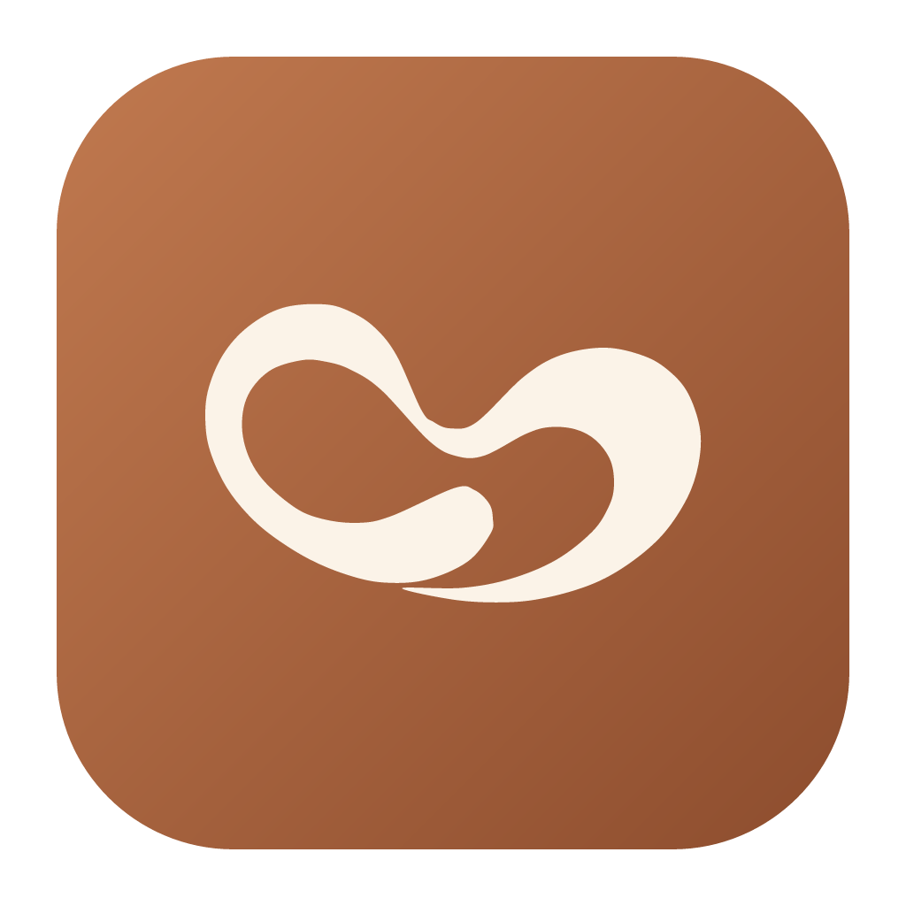
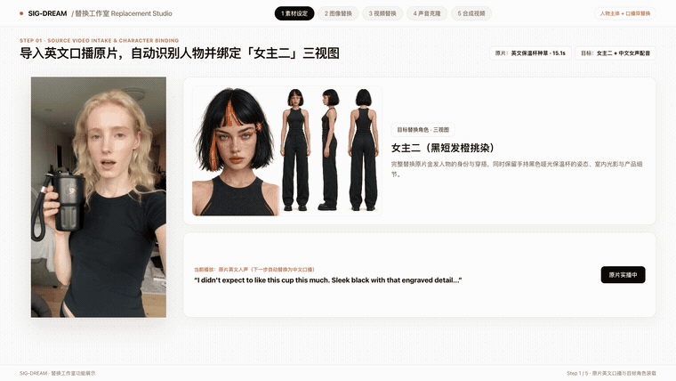
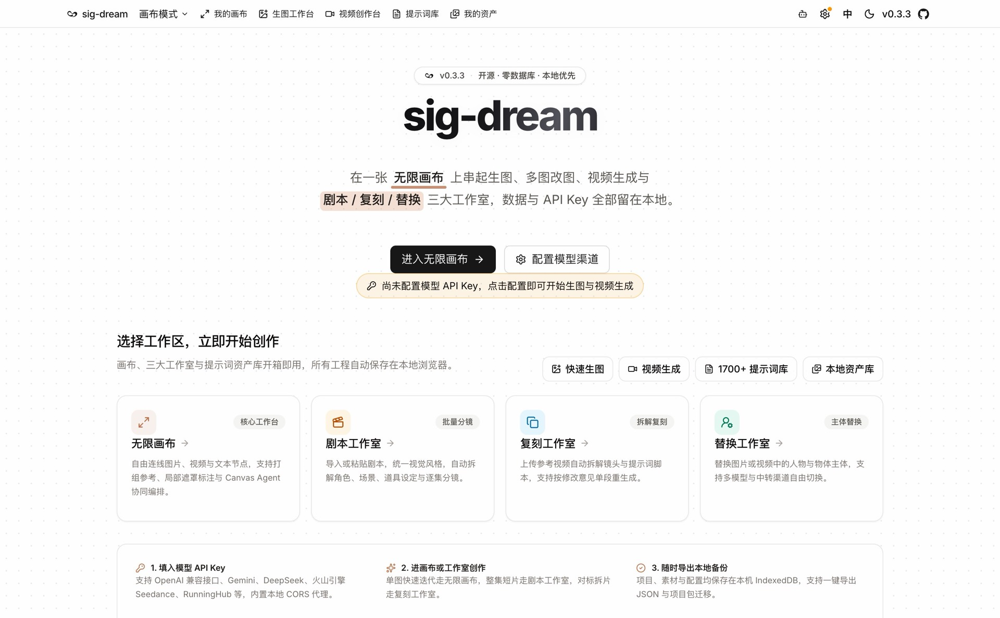
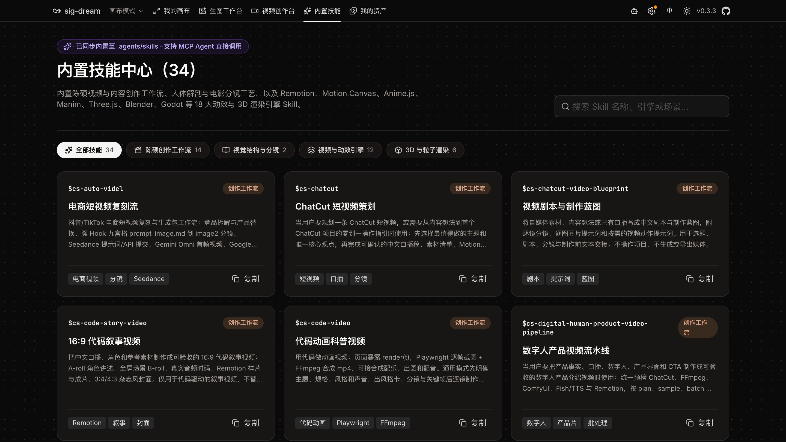
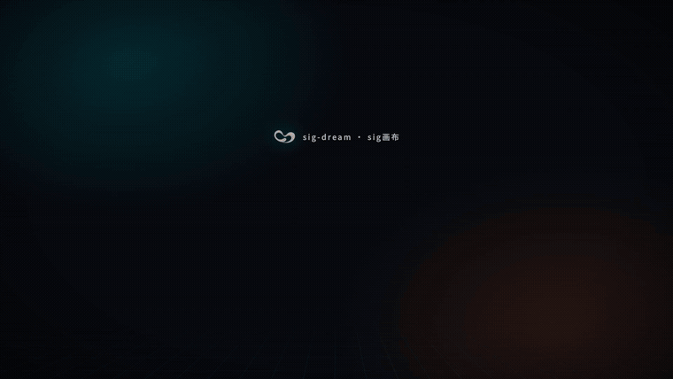

<div align="center">



# sig-dream

**An open-source, zero-database, ready-to-run local-first AI infinite canvas & creative video studio**

Chain **AI image generation, multi-reference editing, video generation, 34+ built-in creative & animation Skills, and 8 MCP Canvas Agents** on one infinite canvas — with built-in **Script**, **Replication**, and **Replacement** studios.  
No PostgreSQL, no login server — download the native desktop app or portable bundle, add your API key, and start creating in 30 seconds.

[](README.md)
[](README.en.md)
[](README.ja.md)
[](README.ko.md)

[](https://github.com/ChenShuo2004/sig-dream/releases/latest)
[](https://github.com/ChenShuo2004/sig-dream/stargazers)
[](LICENSE)
[](https://x.com/ChenshuoAI)

[Download & Quick Start](#download--quick-start) · [Promo & Demos](#promo-film--feature-demos) · [Workspaces](#workspaces) · [Agent Setup](#agent-integration) · [Providers](#supported-models--providers) · [Enterprise (Closed-Source)](#enterprise-edition-closed-source) · [FAQ](#faq)

</div>

<br/>

<div align="center">
  <a href="docs/demos/00-fast-hype-promo.mp4">
    
  </a>
  <p>
    <sub>
      🎬 <b>30s 3D Launch Film</b> (Zero-DB setup → Infinite Canvas character consistency → 8 MCP Agents + 34+ Built-in Skills → 3 Studios) ·
      <a href="https://github.com/ChenShuo2004/sig-dream/raw/main/docs/demos/00-fast-hype-promo.mp4"><b>Download 1080p MP4 with Sound</b></a> ·
      <a href="docs/demos/00-fast-hype-promo.mp4"><b>Repo File</b></a>
    </sub>
  </p>
</div>

### 3 Built-in Studios · Real Output Previews (Click Any GIF for 1080p MP4 with Audio)

| 🎬 Script Studio · Script to Film | ⚡ Replication Studio · Motion & Character | 🎭 Replacement Studio · Video & Voice Swap |
| --- | --- | --- |
| [](docs/demos/03-script-studio.mp4)<br/><sub>Script → 2K character/scene sheets → 16-clip Seedance 2.5 film · [1080p MP4](docs/demos/03-script-studio.mp4)</sub> | [](docs/demos/04-replication-studio.mp4)<br/><sub>Action breakdown → locked hero sheet → 16:9 chase film · [1080p MP4](docs/demos/04-replication-studio.mp4)</sub> | [](docs/demos/06-replacement-studio.mp4)<br/><sub>Original English video ⇄ swapped character + synced Chinese voice · [1080p MP4](docs/demos/06-replacement-studio.mp4)</sub> |

## Why sig-dream?

- **True out-of-the-box setup**: No PostgreSQL, Redis, or account server. Ships as **native macOS / Windows / Linux desktop installers**, a **zero-install Web Portable bundle**, and a **one-command Docker Compose setup**.
- **End-to-end creative studio + 34+ Built-in Skills**: Includes **Script, Replication, and Replacement studios**, **Canvas Agent (8 MCP clients)**, and a **Built-in Skills Center (`/skills`)** synced to `.agents/skills/` with 14 creative workflows, `anatomy` & `video-shotcraft`, plus 18 motion/3D engine skills (Remotion, Motion Canvas, Anime.js, Manim, Three.js, Blender, Godot, etc.).
- **Local-first & private**: Projects, studio documents, local assets, and API keys stay in local IndexedDB / LocalStorage with JSON / `.zip` export/import and optional WebDAV sync. A zero-dependency local CORS proxy ([`server/proxy.mjs`](server/proxy.mjs)) handles providers that block direct browser calls.

---

## Agent Integration

Open **Agent → Connect** inside the app to copy ready-to-use MCP commands/configs for **Codex, Claude, Cursor, Grok Build, OpenCode, Antigravity, Muse Code, or Pi** (plus a generic local stdio MCP entry for other clients). See the full [Agent Connection Guide](docs/agent-connections.md) for setup details and verification.

## Download & Quick Start

### Option 1: Native Desktop App (Recommended · No Node.js Required)

Download the installer for your OS from [**GitHub Releases (Latest)**](https://github.com/ChenShuo2004/sig-dream/releases/latest) (`SHA256SUMS.txt` included):

| Platform | Download | Notes |
| --- | --- | --- |
| **macOS (Apple Silicon M1–M4)** | `sig-dream-*-mac-arm64.dmg` | Drag to Applications and launch — built-in local server, CORS proxy & window-state persistence |
| **macOS (Intel)** | `sig-dream-*-mac-x64.dmg` | Same as above |
| **Windows (x64)** | `sig-dream-*-win-x64-setup.exe` / `.zip` | NSIS installer or portable zip archive |
| **Linux (x64)** | `sig-dream-*-linux-x64.AppImage` / `.deb` | Standalone desktop package |

> [!TIP]
> Community installers are unsigned. On first launch:
> - **macOS**: Right-click → Open, or run `xattr -cr /Applications/sig-dream.app`
> - **Windows**: Click **More info → Run anyway** in SmartScreen

### Option 2: Web Portable Bundle (No `npm install` · Requires Node.js 20+)

Download `sig-dream-*-web-portable.zip` (~3.1 MB) from [**Releases**](https://github.com/ChenShuo2004/sig-dream/releases/latest), unzip, and run:

- **macOS**: Double-click `启动-macOS.command`
- **Windows**: Double-click `启动-Windows.bat`
- **Linux / Terminal**: Run `./start.sh`

### Option 3: Docker Compose

```bash
git clone https://github.com/ChenShuo2004/sig-dream.git
cd sig-dream
npm run access:init
docker compose up -d
```

Then open [http://localhost:3000](http://localhost:3000) and sign in with the password generated in `.env`. The service binds to loopback by default. Public deployment requires a TLS reverse proxy and `SIG_DREAM_SECURE_COOKIE=1`; never commit `.env`.

### Option 4: Run from Source (Node.js 22+ Recommended / 20+ Compatible)

```bash
git clone https://github.com/ChenShuo2004/sig-dream.git
cd sig-dream
npm install
npm run dev
```

---

## Promo Film & Feature Demos

<div align="center">
  <picture>
    <source media="(prefers-color-scheme: dark)" srcset="docs/screenshots/home-overview-dark.jpg" />
    <source media="(prefers-color-scheme: light)" srcset="docs/screenshots/home-overview-light.jpg" />
    
  </picture>
  <p>
    <sub>
      <b>sig-dream Home Overview</b>: Jump straight into Infinite Canvas, Script / Replication / Replacement Studios, 34+ Built-in Skills Center, and Local Assets (adaptive Light & Dark themes)
    </sub>
  </p>
</div>

- **Modular Walkthroughs & Core UI (1080p)**: All clips below feature real end-to-end workflows and generated outputs (click any preview to open the full `1080p` MP4 with audio):

| 01 · Zero-DB Setup & Multi-Provider Config | 02 · Infinite Canvas Orchestration |
| --- | --- |
| [](docs/demos/01-overview-and-config.mp4)<br/><sub>Configure providers, built-in CORS proxy, and WebDAV sync locally · [1080p MP4](docs/demos/01-overview-and-config.mp4)</sub> | [](docs/demos/02-infinite-canvas.mp4)<br/><sub>Connect text/image/video nodes, groups, reference editing & Canvas Agent · [1080p MP4](docs/demos/02-infinite-canvas.mp4)</sub> |

| 03 · Script Studio: Script → 2K Sheets → Film | 04 · Replication Studio: Motion Breakdown → Film |
| --- | --- |
| [](docs/demos/03-script-studio.mp4)<br/><sub>Extract 2K character/scene/prop sheets, build 16-clip storyboards, and render Seedance 2.5 clips · [1080p MP4](docs/demos/03-script-studio.mp4)</sub> | [](docs/demos/04-replication-studio.mp4)<br/><sub>Analyze camera motion, lock a new character sheet, and render 16:9 action-replicated clips · [1080p MP4](docs/demos/04-replication-studio.mp4)</sub> |

| 05 · Replacement Studio: Subject Swap & Voice Clone | 06 · 34+ Built-in Creative & Animation Skills |
| --- | --- |
| [](docs/demos/06-replacement-studio.mp4)<br/><sub>Auto-detect subjects, drag-to-box pixel-accurate swap with preserved hands/lighting, and IndexTTS voice clone · [1080p MP4](docs/demos/06-replacement-studio.mp4)</sub> | <br/><sub>34 built-in creative workflows, anatomy/shotcraft & 18 motion/3D engines synced to `.agents/skills/` for MCP Agents</sub> |

---

## Workspaces

| Workspace | Route | What it does |
| --- | --- | --- |
| **Infinite Canvas** | `/canvas` | Connect image, video, audio, and text nodes; group references, mask editing, and Canvas Agent orchestration. |
| **Script Studio** | `/studio/script` | Turn scripts into consistent character, scene, prop sheets, and episode storyboards. |
| **Replication Studio** | `/studio/replication` | Break down reference videos into shot-by-shot prompts and regenerate individual segments. |
| **Replacement Studio** | `/studio/replacement` | Swap subjects/voices or clone voice timbre across supported providers. |
| **Image & Video** | `/image` · `/video` | Dedicated generation workbenches with first/last-frame & multi-reference modes and automatic task resumption. |
| **Built-in Skills** | `/skills` | 34 preloaded creative & animation Skills (synced to `.agents/skills/`) with category filters, one-click copy, and direct MCP Agent support. |
| **Local Assets** | `/assets` | Organize reusable images, videos, and character sheets locally in your browser. |

---

## Supported Models & Providers

Click the top-right **⚙️ Settings** icon (or **Configure Providers** on the home screen) to add any provider (Base URL + API Key):

- **Standard APIs**: OpenAI-compatible endpoints, Google Gemini, DeepSeek, OpenRouter, etc.
- **Video & Workflow Providers**: Volcengine Ark (Seedance 2.0), RunningHub (ComfyUI workflows & video editing), MiniMax H3, and compatible relays.
- **Built-in CORS Proxy**: Dev mode, production server, Web Portable, and Desktop builds all bundle [`server/proxy.mjs`](server/proxy.mjs) with zero external dependencies.

---

## Development, Testing & Packaging

```bash
# Typecheck & unit tests
npm run typecheck
npm test

# End-to-end UI smoke suite (no API key required)
npm run test:smoke

# Production build & local server
npm run build
npm run start:open

# Build cross-platform Web Portable archive
npm run build:portable

# Run or package Electron desktop app (run `cd desktop && npm install` once first)
npm run desktop:dev
npm run desktop:mac
npm run desktop:win
npm run desktop:linux

# Sync version across package.json, desktop/package.json, and VERSION
npm run version:sync -- 0.3.4
```

---

## Enterprise Edition (Closed-Source)

> [!IMPORTANT]
> **The Enterprise Edition is closed-source and not open-sourced.** This repository contains the MIT-licensed, zero-database Community Edition for local single-user creation. The LAN NAS asset hub, drag-to-NLE team desktop, RBAC permissions, and voice/cover studio shown below belong to the commercial Enterprise Edition.

**From Script to Final Cut. All on One Canvas.**<br/>
Infinite Canvas × LAN Asset Library × Cross-Platform Team Desktop



### Community Edition vs. Enterprise Edition

| Feature | Community Edition (This Repo · MIT) | Enterprise Edition (Closed-Source) |
| --- | --- | --- |
| License | MIT open source, ready-to-run locally | Commercial closed-source license (source not public) |
| Canvas & Studios | Infinite canvas, image/video gen, 34+ built-in creative & motion skills, Script/Replication/Replacement studios | Everything in Community + shared team canvases & full-pipeline production orchestration |
| Distribution & Desktop | Web Portable, Docker, standalone macOS / Windows / Linux desktop app | Team desktop client with LAN NAS library & direct drag-to-NLE editing |
| LAN Asset Hub & NAS | Local IndexedDB storage + JSON / WebDAV backup | PostgreSQL metadata + LAN file machine (NAS direct transfer, auto thumbnails & H.264 previews; originals stay on LAN) |
| Permissions & Audit | No login required (single user) | Dual isolated libraries, 4 roles / 30 granular permissions, full operation audit logs |
| Voice & Cover Studio | — | Local GPU inference (Seed-VC zero-shot timbre conversion + SVS lyric-rewrite cover & A/B compare) |
| Deployment & Support | GitHub Issues community | Private on-premise LAN deployment, multi-node setup & dedicated commercial support |

For full-HD demos, private LAN deployment, or commercial licensing, reach out to [@ChenshuoAI](https://x.com/ChenshuoAI) on X.

---

## FAQ

<details>
<summary><b>Where are my API keys and projects stored?</b></summary>

Everything is stored locally in IndexedDB / LocalStorage. Nothing is sent to any tracking or third-party account server. The built-in `server/proxy.mjs` runs locally only to forward CORS-restricted API requests using your own key.

</details>

<details>
<summary><b>Does the desktop app keep my data and window size after restarting?</b></summary>

Yes. The desktop app binds a stable loopback origin (`http://127.0.0.1:28430`) and persists window bounds automatically. If port `28430` is occupied by another process, the desktop app warns you explicitly so your original local storage remains intact once the port is freed.

</details>

<details>
<summary><b>Should I upgrade from v0.2.0?</b></summary>

Yes. `v0.2.0` was an early build coupled to an older backend architecture. Starting from `v0.3.0`, the open-source edition is completely zero-database and local-first out of the box.

</details>

---

## Credits & License

- Built on [basketikun/infinite-canvas](https://github.com/basketikun/infinite-canvas) (MIT License), extended with Script / Replication / Replacement studios, multi-provider video adapters, and out-of-the-box desktop/portable packaging. Original license preserved at [LICENSE.upstream-infinite-canvas](LICENSE.upstream-infinite-canvas).
- Licensed under the [MIT License](LICENSE).

<div align="center">

[](https://star-history.com/#ChenShuo2004/sig-dream&Date)

</div>
