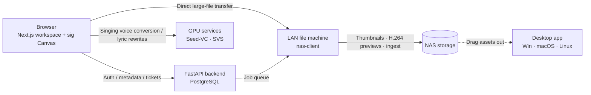
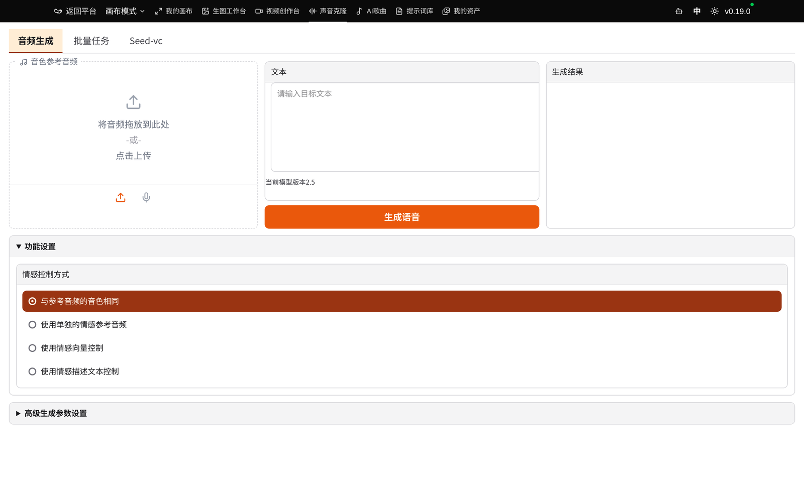
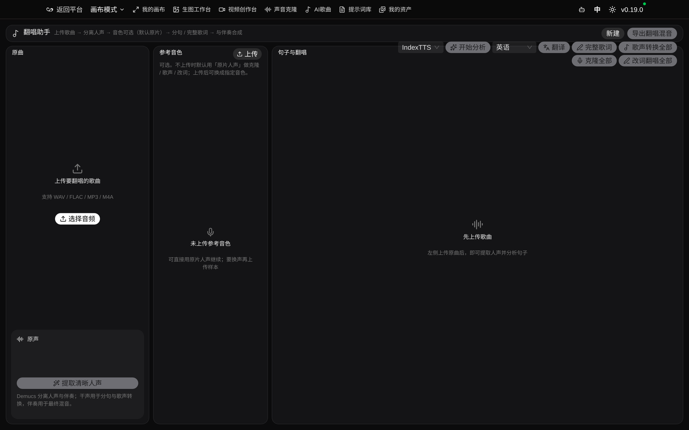

> **中文:** 面向内容团队、可自行部署的 AI 创作画布与素材工作台。[阅读中文文档 →](README.md)

[](README.md)
[](README.en.md)
[](README.ja.md)
[](README.ko.md)
[](https://x.com/ChenshuoAI)
[](https://github.com/ChenShuo2004/sig-dream/releases/latest)
[](LICENSE)

🚀 **[Deploy a canvas for your team](#installation)** · 💻 **[Download the desktop app](#desktop-app)**

# sig-dream · sig Canvas

**Put your team's assets, models and ideas on one canvas.** Chain AI image generation, reference-based editing, video generation, voice-over and song covers on an infinite canvas — and every asset the canvas uses comes from a shared, searchable, permission-controlled material library.

sig-dream is a self-hosted workspace for content teams. The browser is where you create; a FastAPI backend handles auth, metadata and job orchestration; a file machine on your LAN stores originals and generates thumbnails and previews. Original files never detour through the cloud, so uploads and downloads inside the office run at LAN speed.

> The UI is currently in Chinese. Contributions for other UI languages are welcome.




| Workspace | Entry | What it's for |
| --- | --- | --- |
| **sig Canvas** | `/canvas` | Generate and edit images and videos on an infinite canvas; orchestrate the flow with an Agent. |
| **Studios** | Script / Replication / Replacement | Go from script to storyboard, recreate a reference video shot by shot, swap people and objects in footage. |
| **Voice & songs** | Voice / Song / Cover assistant | Record or upload audio for voice-over, split vocals from accompaniment, rewrite lyrics and sing them in a chosen voice. |
| **Material library** | `/materials` | Upload, tag, organize, search and download team assets, isolated per library domain. |


## Screenshots

Captured from a fresh local demo deployment. The canvas images are style previews that ship with the repository; no real business data or keys are shown.

### Select an image to edit it

Select any node, describe the change below, pick a model and image count, and generate — results come back as new nodes linked to the source.


### Prompt library

1,700+ open-source prompts, filterable by source and tag; copy one or add it to your assets for reuse on the canvas.


<details>
<summary>Expand: script studio, voice cloning, cover assistant and the team platform</summary>

### Script studio

Paste or upload a script, lock in a visual style, then break it into characters, scenes and storyboard frames.


### Voice cloning

Upload a reference voice and type text to generate a voice-over; steer emotion by reference audio, emotion vectors or a text description.



### Cover assistant

Upload a track to split vocals and accompaniment, rewrite lyrics line by line in a chosen voice, and A/B against the original.



### Team platform home

Material center, tags & logs, toolbox and administration in one workspace.


### System settings

Users, groups, roles and permission points in one place; every write is recorded in the operation log.


</details>

## Installation

### Requirements

- Python 3.11+
- Node.js 20+
- PostgreSQL (local or managed)
- FFmpeg and FFprobe on your `PATH` (needed by the file machine for thumbnails and previews)
- Optional: a Windows machine with an NVIDIA GPU for the Seed-VC and SVS services
- Optional: a LAN file machine or NAS to hold original files

Clone the repository; all commands below run from the repository root:

```bash
git clone https://github.com/ChenShuo2004/sig-dream.git
cd sig-dream
```

### 1. Backend

macOS/Linux:

```bash
cd backend
python3 -m venv .venv
.venv/bin/pip install -r requirements.txt
cp .env.example .env          # set the database URL and the three secrets
.venv/bin/alembic upgrade head
.venv/bin/uvicorn app.main:app --host 127.0.0.1 --port 8000
```

Windows PowerShell:

```powershell
cd backend
python -m venv .venv
.\.venv\Scripts\pip install -r requirements.txt
Copy-Item .env.example .env   # set the database URL and the three secrets
.\.venv\Scripts\alembic upgrade head
.\.venv\Scripts\uvicorn app.main:app --host 127.0.0.1 --port 8000
```

In `.env`, change at least `DATABASE_URL`, `TOKEN_SECRET`, `NAS_CLIENT_TOKEN` and `DOWNLOAD_TICKET_SECRET`. Then open `http://127.0.0.1:8000/health` to confirm the service is up.

### 2. Build sig Canvas

The canvas is a standalone Vite app. Its build output goes straight into `frontend/public/canvas-app`, where the workspace loads it in an iframe:

```bash
cd canvas-app/web
npm ci
npm run build
```

### 3. Web workspace

```bash
cd frontend
npm ci
npm run dev
```

Open [http://127.0.0.1:3000/](http://127.0.0.1:3000/). The frontend forwards API calls to the backend through the same-origin `/api-proxy` path; the default backend is `http://127.0.0.1:8000`. To change it, set `NEXT_PUBLIC_API_BASE_URL` as shown in `frontend/.env.local.example`.

For production, run `npm run build && npm run start` and put Nginx in front of port `3000`. Full server deployment steps (in Chinese) are in the [backend deployment guide](后端部署指南_V1_Ubuntu22.04.md) and [deployment & environment variables](docs/PROJECT_CONTEXT/07_部署与环境变量.md).

### 4. File machine (optional)

Originals, thumbnails and preview videos are handled by `nas-client` on a LAN file machine. On that machine:

```powershell
cd nas-client
python -m venv .venv
.\.venv\Scripts\pip install -r requirements.txt
Copy-Item nas-client-token.txt.example nas-client-token.txt   # same NAS_CLIENT_TOKEN as the backend
Copy-Item ecs-api-url.txt.example ecs-api-url.txt             # backend URL
```

Then run `start-nas-direct-services.bat` from the repository root to start the download server and job worker together. Without a file machine you can still sign in, use the canvas and manage metadata, but ingest and preview generation won't run.

### 5. GPU services (optional)

The cover assistant relies on two local GPU services. Copy each folder to the GPU machine and double-click `start.bat`:

| Service | Folder | Port | Purpose |
| --- | --- | --- | --- |
| Seed-VC | `seed-vc-service/` | `7865` | Zero-shot singing / speech voice conversion, no training needed |
| SVS | `svs-service/` | `7866` | Generates a guide vocal for new lyrics that follows the original melody |

### First sign-in

The database migrations create an initial super admin: username `admin`, password `admin123`.

> ⚠️ **Change this password right after signing in** (System Settings → Users), or create your own admin and disable this account. Never keep the default password on a public deployment.

The canvas is available to the "material admin" and "super admin" roles; grant access to other members through permission points in System Settings.

## Desktop app

The desktop app runs on Windows, macOS and Linux. It signs in to your team server so you can browse the material library and collections, open the canvas, and drag assets straight into your editing software. Download the installer for your system from [Releases](https://github.com/ChenShuo2004/sig-dream/releases/latest):

| System | Installer | Notes |
| --- | --- | --- |
| **Windows 10/11** | `sig-dream-<version>-win-x64-setup.exe` | Installer; a portable `.zip` is also available |
| **macOS (Apple silicon)** | `sig-dream-<version>-mac-arm64.dmg` | M1 / M2 / M3 / M4 and later |
| **macOS (Intel)** | `sig-dream-<version>-mac-x64.dmg` | Intel-based Macs |
| **Linux** | `sig-dream-<version>-linux-x86_64.AppImage` | Universal; a `.deb` is also provided for Debian / Ubuntu |

On first launch, enter your team's website address in **服务器地址 (Server address)** on the sign-in screen — the same address you use in the browser — then save and sign in. The address is stored only on your computer; the installers contain no server addresses or credentials.

The installers aren't code-signed yet, so your system may block the first launch:

- **Windows**: when "Windows protected your PC" appears, click **More info → Run anyway**.
- **macOS**: if you see "is damaged" or "cannot verify the developer", move the app to Applications and run once:

  ```bash
  xattr -cr /Applications/sig-dream.app
  ```

- **Linux**: make the AppImage executable first:

  ```bash
  chmod +x sig-dream-*-linux-x86_64.AppImage
  ```

The app checks GitHub Releases for new versions automatically, and you can also check manually from the settings page. To run or package from source, see [desktop-client/README.md](desktop-client/README.md).

## Features

| Feature | Description |
| --- | --- |
| Infinite canvas | Wire image, video, text and audio nodes together; group nodes, multi-select, and feed a whole group in as generation input. |
| AI image generation & editing | Works with the OpenAI / Gemini API ecosystem; multi-reference editing, masked region notes, 1K / 2K / 4K sizes. |
| Video generation | First/last-frame and all-reference modes; remote jobs resume after a page refresh; grab the first, last or current frame from a video. |
| Canvas Agent | An Agent reads and writes canvas nodes directly; external agents such as Codex can join in. |
| Script studio | Set one visual style and plan characters, scenes, props and storyboard frames. |
| Replication studio | Recreate a reference video segment by segment, with review, fix-by-feedback and per-segment regeneration. |
| Replacement studio | Swap people or objects in images and videos, with separate image and video replacement models. |
| Voice & covers | Record or upload a reference voice for voice-over; split vocals and accompaniment, rewrite lyrics line by line, A/B against the original. |
| Prompt library | Several built-in open-source prompt sources; add any prompt to your assets and reuse it on the canvas. |
| Two library domains | Two independent material libraries on one platform; lists, tags, unsorted items, uploads and collections never cross over. |
| Tagging & triage | Dynamic tag categories, tag replacement and review; assets with no tags or an "unsorted" tag are queued for triage. |
| Collections | Organize assets by reference — no file copies, originals stay where they are. |
| LAN-first transfer | Downloads try the LAN file machine, then the WAN file machine, then a server-side cache; large uploads are chunked and verified. |
| Thumbnails & previews | The file machine generates thumbnails and H.264 preview MP4s asynchronously, keeping transcoding off the server. |
| Roles & permissions | One role-permission matrix; every write is recorded in the operation log and can be audited per user. |
| Guided tutorials | Interactive in-page walkthroughs that track each member's progress. |
| Desktop app | Windows / macOS / Linux; drag assets into editing software; updates itself from GitHub Releases. |

## Tips

### Start from the canvas

Add a model channel (Base URL + API key) in the canvas settings at the top right, test the connection, and start generating. Keys are stored only in your browser, and you can export a config file to share within your team.

### Start from assets

Upload at `/materials/upload`. After ingest, tag items in bulk on the "unsorted" page. Organized assets can go into collections or be referenced directly on the canvas.

### Start from a song

Open the cover assistant and upload a track; vocals and accompaniment are split automatically. Write new lyrics line by line and pick a reference voice — the guide vocal is converted to that voice by Seed-VC, and every line can be compared with the original.

## Running & data

| Data | Location |
| --- | --- |
| Users, permissions, asset metadata, jobs and logs | PostgreSQL |
| Original files, thumbnails, preview videos | File machine / NAS (`NAS_MOUNT_ROOT`) |
| Canvas projects, generated images, model configs | Browser IndexedDB, with optional WebDAV sync |

`.env*`, file-machine tokens, NAS credentials, virtual environments, `node_modules` and local database backups are all git-ignored; only `*.example` templates are committed. Never post API keys, database connection strings or internal addresses in issues, logs, screenshots or commits.

## Development checks

```bash
# sig Canvas: type check and unit tests
(cd canvas-app/web && npm run typecheck && npm test)

# Web workspace: production build
(cd frontend && npm run build)

# Desktop app: renderer build (installers are built by GitHub Actions)
(cd desktop-client && npm run build)

# File machine: thumbnail and person-detection pipeline tests
(cd nas-client && python test_studio_media.py && python test_person_pipeline.py)
```

For database schema changes, add a new Alembic migration rather than editing existing ones.

## Project structure

```text
├── backend/              # FastAPI backend: auth, assets, tags, collections, canvas and studio APIs
├── frontend/             # Next.js workspace: material library, settings, tutorials; embeds sig Canvas
├── canvas-app/           # sig Canvas (a Vite app built on infinite-canvas)
├── desktop-client/       # Electron desktop app (Windows / macOS / Linux)
├── nas-client/           # File machine: download server, job worker, thumbnails and preview transcoding
├── seed-vc-service/      # Seed-VC singing voice conversion service
├── svs-service/          # SVS lyric-rewrite guide vocal service
├── docs/PROJECT_CONTEXT/ # Architecture, modules, database, API and deployment docs (Chinese)
├── scripts/ · tools/     # Database backup, preview backfill and other ops scripts
└── deploy.sh             # One-step server release script
```

To dig into the implementation, start with the [project overview](docs/PROJECT_CONTEXT/00_项目总览.md) and [system architecture](docs/PROJECT_CONTEXT/01_系统架构.md) (in Chinese).

## Acknowledgements

sig Canvas is built on [basketikun/infinite-canvas](https://github.com/basketikun/infinite-canvas) (MIT License). On top of its infinite canvas, image, video and Agent features, it adds the studios, voice, song and cover assistant, and connects them to the team material library and accounts. The original license is kept at [canvas-app/LICENSE](canvas-app/LICENSE).

Thanks also to [ComfyUI](https://github.com/comfyanonymous/ComfyUI), [Seed-VC](https://github.com/Plachtaa/seed-vc), [Bootstrap Icons](https://github.com/twbs/icons) and the authors of every open-source prompt library.

## Star history

[](https://star-history.com/#ChenShuo2004/sig-dream&Date)

## Contributing

Issues and pull requests are welcome. Before making changes, read the [key design decisions](docs/PROJECT_CONTEXT/09_关键设计决策.md): library-domain isolation, reference semantics for collections, LAN-first transfer and permission-point checks all have firm constraints. Any endpoint that writes data should also record an operation log entry.

## License

This project is released under the [MIT License](LICENSE). Code in `canvas-app/` derived from infinite-canvas also remains under its original [MIT License](canvas-app/LICENSE).
