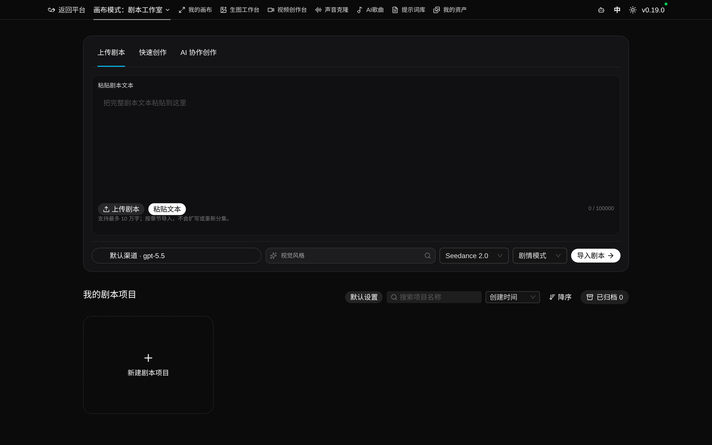

<div align="center">

# sig-dream · sig Canvas

**An open-source, zero-database, local-first AI infinite canvas & creative video studio**

Chain AI image generation, multi-reference editing, video generation, 1,700+ open-source prompts, and Canvas Agent on one infinite canvas — with built-in **Script**, **Replication**, and **Replacement** studios.  
No PostgreSQL, no login server — add your API key and start creating in 30 seconds.

[](README.md)
[](README.en.md)
[](README.ja.md)
[](README.ko.md)

[](https://x.com/ChenshuoAI)
[](https://github.com/ChenShuo2004/sig-dream/stargazers)
[](LICENSE)

[Quick Start](#-30-second-quick-start) · [Workspaces](#-workspaces) · [Enterprise (Closed-Source)](#-enterprise-edition-closed-source) · [Providers](#-supported-models--providers) · [Docker](#option-2-docker-one-liner) · [FAQ](#-faq)

</div>

<br/>


## Why sig-dream?

- **Zero setup friction**: No PostgreSQL, Redis, or account server. Start with `npm run dev` or one `docker run` command and start generating immediately.
- **More than a node canvas**: Combines an infinite node canvas with **Script, Replication, and Replacement studios**, **1,700+ curated prompts**, and a **Canvas Agent**.
- **Local-first & private**: Projects, studio documents, assets, and API keys stay in your browser's IndexedDB / LocalStorage with JSON export/import. A tiny zero-dependency local CORS proxy handles providers that block direct browser requests.

---

## Workspaces

| Workspace | Route | What it does |
| --- | --- | --- |
| **Infinite Canvas** | `/canvas` | Connect image, video, and text nodes; group references, mask editing, and Canvas Agent orchestration. |
| **Image & Video** | `/image` · `/video` | Dedicated generation views with first/last-frame & multi-reference modes and automatic task resumption. |
| **Script Studio** | `/studio/script` | Turn scripts into consistent character, scene, prop sheets, and episode storyboards. |
| **Replication Studio** | `/studio/replication` | Break down reference videos into shot-by-shot prompts and regenerate individual segments. |
| **Replacement Studio** | `/studio/replacement` | Swap subjects or objects in images and videos across supported providers. |
| **Prompt Library** | `/prompts` | Browse and filter 1,700+ open-source prompts; copy or save directly to local assets. |
| **Local Assets** | `/assets` | Organize reusable images, videos, and text snippets locally in your browser. |

---

## Preview

### Select Any Image Node to Edit


### Script Studio



### Built-in 1,700+ Prompt Library


---

## 🏢 Enterprise Edition (Closed-Source)

> [!IMPORTANT]
> **The Enterprise Edition is closed-source and not open-sourced.** This repository contains the MIT-licensed, zero-database Community Edition for local single-user creation. The LAN asset hub, cross-platform desktop client, RBAC permissions, and voice/cover studio shown below belong to the commercial Enterprise Edition.

**From Script to Final Cut. All on One Canvas.**<br/>
Infinite Canvas × LAN Asset Library × Cross-Platform Desktop Drag-to-Edit


### Community Edition vs. Enterprise Edition

| Feature | Community Edition (This Repo · MIT) | Enterprise Edition (Closed-Source) |
| --- | --- | --- |
| License | MIT open source, 30-second local launch | Commercial closed-source license (source not public) |
| Canvas & Studios | Infinite canvas, image/video gen, 1,700+ prompts, Script/Replication/Replacement studios | Everything in Community + shared team canvases & full-pipeline production orchestration |
| LAN Asset Hub & NAS | Browser IndexedDB local storage | PostgreSQL metadata + LAN file machine (NAS direct transfer, auto thumbnails & H.264 previews; originals stay on LAN) |
| Desktop Client | Browser only | Native Windows / macOS / Linux desktop client with direct drag-to-NLE editing |
| Permissions & Audit | No login required (single user) | Dual isolated libraries, 4 roles / 30 granular permissions, full operation audit logs |
| Voice & Cover Studio | — | Local GPU inference (Seed-VC zero-shot timbre conversion + SVS lyric-rewrite cover & A/B compare) |
| Deployment & Support | GitHub Issues community | Private on-premise LAN deployment, multi-node setup & dedicated commercial support |

For full-HD demos, private LAN deployment, or commercial licensing, reach out to [@ChenshuoAI](https://x.com/ChenshuoAI) on X.

---

## Supported Models & Providers

Add any provider (Base URL + API Key) in the top-right **Settings** panel:

- **Standard APIs**: OpenAI-compatible endpoints, Google Gemini, DeepSeek, OpenRouter, etc.
- **Video & Workflow Providers**: Volcengine Ark (Seedance 2.0), RunningHub (ComfyUI workflows & video editing), MiniMax H3, and compatible relays.
- **Built-in CORS Proxy**: Both `npm run dev` and `npm start` include [`server/proxy.mjs`](server/proxy.mjs) with zero external dependencies.

---

## 30-Second Quick Start

### Option 1: Local Node.js (Recommended)

Requires **Node.js 20+**:

```bash
git clone https://github.com/ChenShuo2004/sig-dream.git
cd sig-dream
npm install --legacy-peer-deps
npm run dev
```

Open [http://localhost:3000](http://localhost:3000). For production builds:

```bash
npm run build
npm start
```

### Option 2: Docker One-Liner

```bash
git clone https://github.com/ChenShuo2004/sig-dream.git
cd sig-dream
docker build -t sig-dream .
docker run -d --name sig-dream -p 3000:3000 sig-dream
```

Then visit [http://localhost:3000](http://localhost:3000).

---

## FAQ

<details>
<summary><b>Where are my API keys and projects stored?</b></summary>

Everything is stored locally in your browser (IndexedDB / LocalStorage). Nothing is sent to any tracking or third-party account server. The built-in `server/proxy.mjs` runs locally only to forward CORS-restricted API requests using your own key.

</details>

<details>
<summary><b>Why <code>--legacy-peer-deps</code> during npm install?</b></summary>

The app runs on React 19 while a few UI libraries still declare React 18 in their peerDependencies. `--legacy-peer-deps` installs cleanly.

</details>

---

## Credits & License

- Built on [basketikun/infinite-canvas](https://github.com/basketikun/infinite-canvas) (MIT License), extended with Script / Replication / Replacement studios and multi-provider video adapters. Original license preserved at [LICENSE.upstream-infinite-canvas](LICENSE.upstream-infinite-canvas).
- Licensed under the [MIT License](LICENSE).

<div align="center">

[](https://star-history.com/#ChenShuo2004/sig-dream&Date)

</div>
