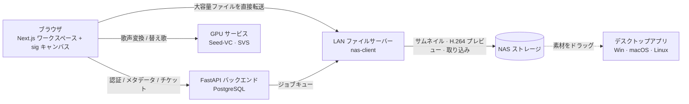

> **English:** A self-hosted AI creation canvas and asset workspace for content teams. [Read in English →](README.en.md)

[](README.md)
[](README.en.md)
[](README.ja.md)
[](README.ko.md)
[](https://x.com/ChenshuoAI)
[](https://github.com/ChenShuo2004/sig-dream/releases/latest)
[](LICENSE)

🚀 **[チーム用キャンバスをデプロイする](#インストール)** · 💻 **[デスクトップアプリをダウンロード](#デスクトップアプリ)**

# sig-dream · sig キャンバス

**チームの素材・モデル・アイデアを、ひとつのキャンバスに。** 無限キャンバス上で AI 画像生成、参考画像による編集、動画生成、ナレーション、歌のカバーをつなげられます。キャンバスで使う素材はすべて、チームで共有・検索でき、権限管理された素材ライブラリから取り出せます。

sig-dream はコンテンツチーム向けのセルフホスト型ワークスペースです。制作はブラウザで行い、認証・メタデータ・ジョブ管理は FastAPI バックエンドが、原本の保存とサムネイル・プレビューの生成は LAN 内のファイルサーバーが担当します。原本ファイルはクラウドを経由しないため、オフィス内では LAN の速度でアップロード・ダウンロードできます。

> 現在、UI は中国語のみです。ほかの言語への翻訳コントリビューションを歓迎します。




| ワークスペース | 入口 | 用途 |
| --- | --- | --- |
| **sig キャンバス** | `/canvas` | 無限キャンバス上で画像・動画を生成・編集し、Agent で制作フローを組み立てます。 |
| **スタジオ** | 脚本 / 複製 / 置き換え | 脚本から絵コンテへ、参考動画をシーンごとに再現、映像内の人物や物を置き換えます。 |
| **音声と歌** | ナレーション / 歌 / カバーアシスタント | 録音やアップロードした音声でナレーションを作成し、ボーカルと伴奏を分離、歌詞を書き換えて指定の声で歌わせます。 |
| **素材ライブラリ** | `/materials` | チームの素材をアップロード、タグ付け、整理、検索、ダウンロード。ライブラリ領域ごとに分離されます。 |


## 画面プレビュー

ローカルに新規デプロイしたデモ環境で撮影しています。キャンバスの画像はリポジトリ同梱のスタイルプレビューで、実際の業務データやキーは含まれていません。

### 画像を選んで編集

任意のノードを選び、下の欄に変更内容を入力してモデルと枚数を選べば生成できます。結果は元画像につながる新しいノードとして追加されます。


### プロンプトライブラリ

1,700 件以上のオープンソースプロンプトを内蔵。出典やタグで絞り込み、コピーまたは素材に追加してキャンバスで再利用できます。


<details>
<summary>展開：脚本スタジオ、音声クローン、カバーアシスタント、チームプラットフォーム</summary>

### 脚本スタジオ

脚本を貼り付けまたはアップロードし、ビジュアルスタイルを決めてキャラクター・シーン・絵コンテに分解します。


### 音声クローン

参考音声をアップロードしてテキストを入力するとナレーションを生成。参考音声・感情ベクトル・テキスト説明で感情を制御できます。


### カバーアシスタント

原曲をアップロードしてボーカルと伴奏を分離し、一行ずつ歌詞を書き換えて指定の声に変換、原曲と聴き比べられます。


### チームプラットフォームのホーム

素材センター、タグとログ、ツールボックス、システム管理をひとつのワークスペースに。


### システム設定

ユーザー、グループ、ロール、権限ポイントを一元管理。すべての書き込みは操作ログに記録されます。


</details>

## インストール

### 動作要件

- Python 3.11 以上
- Node.js 20 以上
- PostgreSQL（ローカルでもクラウドでも可）
- FFmpeg と FFprobe（`PATH` に追加。ファイルサーバーでのサムネイル・プレビュー生成に必要）
- 任意：Seed-VC と SVS サービス用の NVIDIA GPU 搭載 Windows マシン
- 任意：原本を保存する LAN ファイルサーバーまたは NAS

リポジトリを取得します。以降のコマンドはすべてリポジトリのルートで実行します：

```bash
git clone https://github.com/ChenShuo2004/sig-dream.git
cd sig-dream
```

### 1. バックエンド

macOS/Linux：

```bash
cd backend
python3 -m venv .venv
.venv/bin/pip install -r requirements.txt
cp .env.example .env          # データベース接続と 3 つのシークレットを設定
.venv/bin/alembic upgrade head
.venv/bin/uvicorn app.main:app --host 127.0.0.1 --port 8000
```

Windows PowerShell：

```powershell
cd backend
python -m venv .venv
.\.venv\Scripts\pip install -r requirements.txt
Copy-Item .env.example .env   # データベース接続と 3 つのシークレットを設定
.\.venv\Scripts\alembic upgrade head
.\.venv\Scripts\uvicorn app.main:app --host 127.0.0.1 --port 8000
```

`.env` では少なくとも `DATABASE_URL`、`TOKEN_SECRET`、`NAS_CLIENT_TOKEN`、`DOWNLOAD_TICKET_SECRET` を変更してください。起動後、`http://127.0.0.1:8000/health` で動作を確認できます。

### 2. sig キャンバスをビルド

キャンバスは独立した Vite アプリです。ビルド結果は `frontend/public/canvas-app` に直接出力され、ワークスペースが iframe で読み込みます：

```bash
cd canvas-app/web
npm ci --legacy-peer-deps
npm run build
```

### 3. Web ワークスペース

```bash
cd frontend
npm ci
npm run dev
```

[http://127.0.0.1:3000/](http://127.0.0.1:3000/) を開きます。フロントエンドは同一オリジンの `/api-proxy` 経由でバックエンドに転送します（既定は `http://127.0.0.1:8000`）。変更する場合は `frontend/.env.local.example` を参考に `NEXT_PUBLIC_API_BASE_URL` を設定してください。

本番環境では `npm run build && npm run start` を実行し、Nginx で `3000` 番ポートにリバースプロキシします。クラウドサーバーなしの社内 LAN 構成は [LAN デプロイガイド](docs/局域网部署指南.md)（中国語）、Linux サーバー構成は [サーバーデプロイガイド](docs/服务器部署指南.md) を参照してください。

### 4. ファイルサーバー（任意）

原本・サムネイル・プレビュー動画は、LAN ファイルサーバー上の `nas-client` が処理します。ファイルサーバーで：

```powershell
cd nas-client
python -m venv .venv
.\.venv\Scripts\pip install -r requirements.txt
Copy-Item nas-client-token.txt.example nas-client-token.txt   # バックエンドと同じ NAS_CLIENT_TOKEN を記入
Copy-Item ecs-api-url.txt.example ecs-api-url.txt             # バックエンドの URL を記入
```

その後、リポジトリのルートで `start-nas-direct-services.bat` を実行すると、ダウンロードサーバーとジョブワーカーが同時に起動します。ファイルサーバーがなくてもログイン、キャンバス、メタデータ管理は使えますが、取り込みとプレビュー生成は実行されません。

### 5. GPU サービス（任意）

カバーアシスタントは 2 つのローカル GPU サービスを使います。各フォルダを GPU マシンにコピーし、`start.bat` をダブルクリックします：

| サービス | フォルダ | ポート | 役割 |
| --- | --- | --- | --- |
| Seed-VC | `seed-vc-service/` | `7865` | ゼロショットの歌声・話し声の声質変換（学習不要） |
| SVS | `svs-service/` | `7866` | 新しい歌詞のガイドボーカルを原曲のメロディに沿って生成 |

### 初回ログイン

データベースのマイグレーションで、初期スーパー管理者（ユーザー名 `admin`、パスワード `admin123`）が作成されます。

> ⚠️ **ログイン後すぐに「システム設定 → ユーザー」でパスワードを変更してください。** または自分の管理者アカウントを作成し、このアカウントを無効にしてください。公開環境で初期パスワードを残さないでください。

キャンバスは「素材管理者」と「スーパー管理者」ロールで利用できます。ほかのメンバーには、システム設定の権限ポイントで付与してください。

## デスクトップアプリ

デスクトップアプリは Windows、macOS、Linux に対応しています。チームのサーバーにログインして素材ライブラリやコレクションを閲覧し、キャンバスを開き、素材を編集ソフトへ直接ドラッグできます。[Releases](https://github.com/ChenShuo2004/sig-dream/releases/latest) から OS に合ったインストーラーをダウンロードしてください：

| OS | インストーラー | 備考 |
| --- | --- | --- |
| **Windows 10/11** | `sig-dream-<バージョン>-win-x64-setup.exe` | インストーラー版。ポータブル版の `.zip` もあります |
| **macOS（Apple シリコン）** | `sig-dream-<バージョン>-mac-arm64.dmg` | M1 / M2 / M3 / M4 など |
| **macOS（Intel）** | `sig-dream-<バージョン>-mac-x64.dmg` | Intel プロセッサ搭載の Mac |
| **Linux** | `sig-dream-<バージョン>-linux-x86_64.AppImage` | 汎用形式。Debian / Ubuntu 向けの `.deb` もあります |

初回起動時、ログイン画面の **服务器地址（サーバーアドレス）** にチームの Web サイトのアドレス（ブラウザで開くアドレスと同じ）を入力して保存し、ログインしてください。アドレスはお使いのコンピューターにのみ保存され、インストーラーにはサーバーアドレスや認証情報は含まれていません。

インストーラーはまだコード署名されていないため、初回起動時にブロックされることがあります：

- **Windows**：「Windows によって PC が保護されました」と表示されたら、**詳細情報 → 実行** をクリックします。
- **macOS**：「壊れている」「開発元を検証できません」と表示されたら、アプリを「アプリケーション」に移動してから一度だけ実行します：

  ```bash
  xattr -cr /Applications/sig-dream.app
  ```

- **Linux**：AppImage に実行権限を付けます：

  ```bash
  chmod +x sig-dream-*-linux-x86_64.AppImage
  ```

アプリは GitHub Releases の新バージョンを自動で確認します。設定画面から手動で確認することもできます。ソースからの実行やパッケージ作成は [desktop-client/README.md](desktop-client/README.md) を参照してください。

## 主な機能

| 機能 | 説明 |
| --- | --- |
| 無限キャンバス | 画像・動画・テキスト・音声ノードを自由に接続。グループ化、複数選択、グループ全体を生成の入力に使えます。 |
| AI 画像生成と編集 | OpenAI / Gemini API エコシステムに対応。複数参考画像での編集、部分マスクの注記、1K / 2K / 4K サイズ。 |
| 動画生成 | 先頭・末尾フレーム指定と全参照モード。ページを更新してもリモートジョブを自動で追跡し、動画から先頭・末尾・現在のフレームを切り出せます。 |
| Canvas Agent | Agent がキャンバスのノードを直接読み書き。Codex などの外部 Agent とも連携できます。 |
| 脚本スタジオ | ビジュアルスタイルを統一し、キャラクター・シーン・小道具・絵コンテを計画します。 |
| 複製スタジオ | 参考動画をセグメントごとに再現。レビュー、指摘に基づく修正、セグメント単位の再生成に対応。 |
| 置き換えスタジオ | 画像や動画内の人物・物を置き換え。画像用と動画用のモデルを個別に選べます。 |
| ナレーションとカバー | 参考音声を録音・アップロードしてナレーションを生成。ボーカルと伴奏を分離し、一行ずつ歌詞を書き換えて原曲と聴き比べられます。 |
| プロンプトライブラリ | オープンソースのプロンプト集を複数内蔵。素材に追加してキャンバスで再利用できます。 |
| 2 つのライブラリ領域 | 1 つのプラットフォームに独立した 2 つの素材ライブラリ。一覧・タグ・未整理・アップロード・コレクションが混ざりません。 |
| タグ付けと整理 | 動的なタグ分類、タグの置き換えと審査。タグなし、または「未整理」タグの素材をまとめて処理できます。 |
| コレクション | 参照で素材を整理。ファイルを複製せず、原本の保存場所も変わりません。 |
| LAN 優先の転送 | ダウンロードは LAN ファイルサーバー → WAN ファイルサーバー → サーバーキャッシュの順。大容量ファイルは分割アップロードして検証します。 |
| サムネイルとプレビュー | ファイルサーバーがサムネイルと H.264 プレビュー MP4 を非同期で生成し、サーバーにトランスコードの負荷をかけません。 |
| ロールと権限 | ロールと権限ポイントのマトリクスで一元管理。すべての書き込みを操作ログに記録し、ユーザーごとに監査できます。 |
| チュートリアル | ページ内のインタラクティブなガイドで、メンバーごとの進捗を記録します。 |
| デスクトップアプリ | Windows / macOS / Linux に対応。素材を編集ソフトへドラッグでき、GitHub Releases から自動更新します。 |

## 使い方のヒント

### キャンバスから始める

キャンバス右上の設定でモデルのチャネル（Base URL と API キー）を追加し、接続テストに成功したら生成を始められます。キーはブラウザ内にのみ保存され、設定ファイルをエクスポートしてチームで共有することもできます。

### 素材から始める

`/materials/upload` で素材をアップロードし、取り込み後に「未整理」ページでまとめてタグ付けします。整理した素材はコレクションに追加したり、キャンバスで参考画像として直接使ったりできます。

### 1 曲から始める

カバーアシスタントを開いて原曲をアップロードすると、ボーカルと伴奏が自動で分離されます。一行ずつ新しい歌詞を入力し、参考の声を選ぶと、ガイドボーカルが Seed-VC でその声に変換されます。各行は原曲と聴き比べられます。

## 実行とデータ

| データ | 保存場所 |
| --- | --- |
| ユーザー、権限、素材メタデータ、ジョブ、ログ | PostgreSQL |
| 原本ファイル、サムネイル、プレビュー動画 | ファイルサーバー / NAS（`NAS_MOUNT_ROOT`） |
| キャンバスのプロジェクト、生成画像、モデル設定 | ブラウザの IndexedDB（WebDAV 同期も可） |

`.env*`、ファイルサーバーのトークン、NAS の認証情報、仮想環境、`node_modules`、ローカルのデータベースバックアップはすべて Git の管理対象外で、リポジトリには `*.example` テンプレートのみを含みます。API キー、データベース接続文字列、内部アドレスを Issue、ログ、スクリーンショット、コミットに載せないでください。

## 開発時の確認

```bash
# sig キャンバス：型チェックとユニットテスト
(cd canvas-app/web && npm run typecheck && npm test)

# Web ワークスペース：本番ビルド
(cd frontend && npm run build)

# デスクトップアプリ：画面のビルド（インストーラーは GitHub Actions でビルド）
(cd desktop-client && npm run build)

# ファイルサーバー：サムネイルと人物検出パイプラインのテスト
(cd nas-client && python test_studio_media.py && python test_person_pipeline.py)
```

データベースのスキーマを変更するときは、既存のマイグレーションを編集せず、新しい Alembic マイグレーションを追加してください。

## プロジェクト構成

```text
├── backend/              # FastAPI バックエンド：認証、素材、タグ、コレクション、キャンバス、スタジオの API
├── frontend/             # Next.js ワークスペース：素材ライブラリ、システム設定、チュートリアル。sig キャンバスを内蔵
├── canvas-app/           # sig キャンバス（infinite-canvas をベースにした Vite アプリ）
├── desktop-client/       # Electron デスクトップアプリ（Windows / macOS / Linux）
├── nas-client/           # ファイルサーバー：ダウンロードサーバー、ジョブワーカー、サムネイルとプレビューの変換
├── seed-vc-service/      # Seed-VC 歌声変換サービス
├── svs-service/          # SVS 替え歌ガイドボーカルサービス
├── docs/                 # 開発の歩み、デプロイガイド、タグ説明。archive/ は過程ドキュメントの保管場所
├── scripts/ · tools/     # データベースのバックアップ、プレビューの再生成などの運用スクリプト
└── deploy.sh             # サーバー側のワンステップリリーススクリプト
```

ドキュメント（中国語）：[LAN デプロイ](docs/局域网部署指南.md) · [サーバーデプロイ](docs/服务器部署指南.md) · [デスクトップクライアント](desktop-client/README.md) · [タグ説明](docs/标签说明.md)。

## 謝辞

sig キャンバスは [basketikun/infinite-canvas](https://github.com/basketikun/infinite-canvas)（MIT License）をベースに開発しています。無限キャンバス、画像生成、動画、Agent の機能に加えて、スタジオ、ナレーション、歌、カバーアシスタントを追加し、チームの素材ライブラリとアカウント権限に接続しました。元のライセンスは [canvas-app/LICENSE](canvas-app/LICENSE) に保持しています。

[ComfyUI](https://github.com/comfyanonymous/ComfyUI)、[Seed-VC](https://github.com/Plachtaa/seed-vc)、[Bootstrap Icons](https://github.com/twbs/icons)、そしてすべてのオープンソースのプロンプト集の作者に感謝します。

## Star の推移

[](https://star-history.com/#ChenShuo2004/sig-dream&Date)

## コントリビューション

Issue や Pull Request を歓迎します。ライブラリ領域の分離、コレクションの参照セマンティクス、LAN 優先の転送、権限ポイントのチェックを壊さないようにしてください。データを書き込むエンドポイントでは、操作ログの記録も追加してください。

## ライセンス

本プロジェクトは [MIT License](LICENSE) で公開しています。`canvas-app/` 内の infinite-canvas 由来のコードは、元の [MIT License](canvas-app/LICENSE) にも従います。
