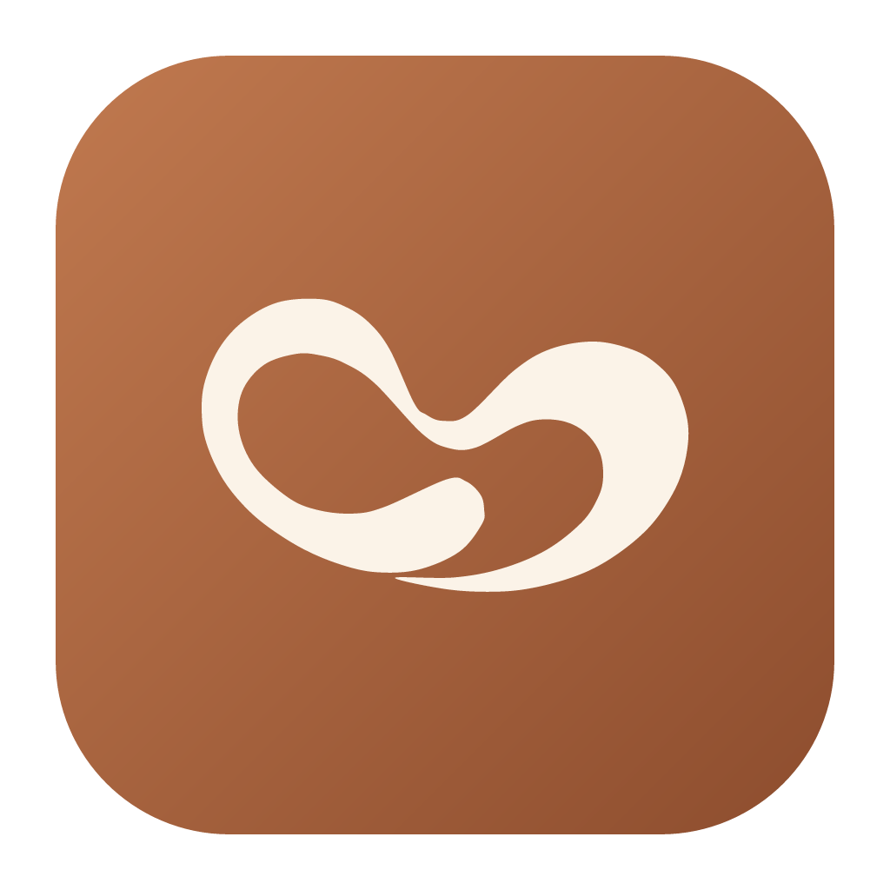
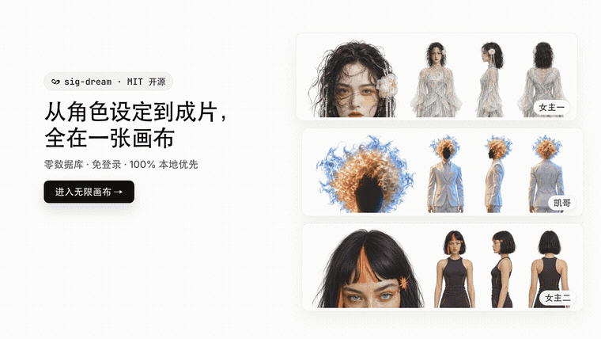
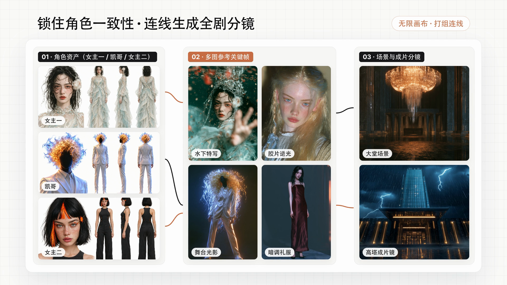
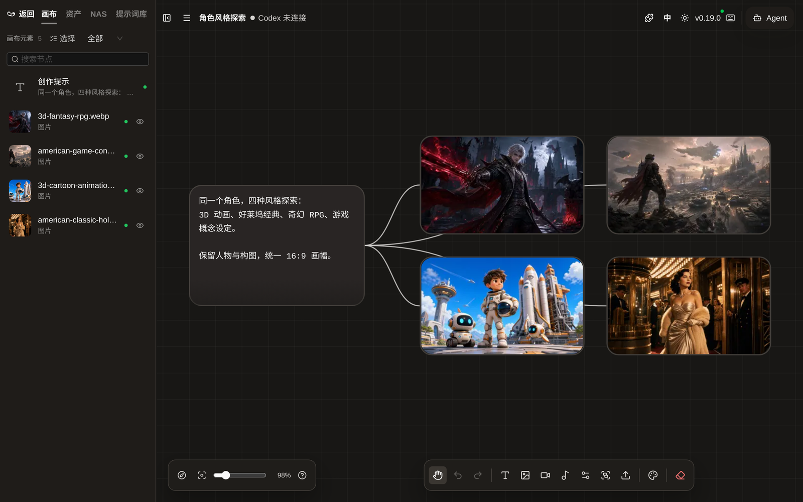
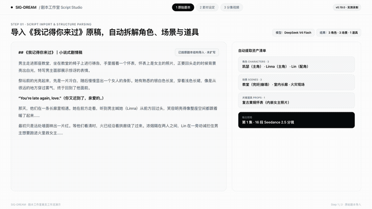
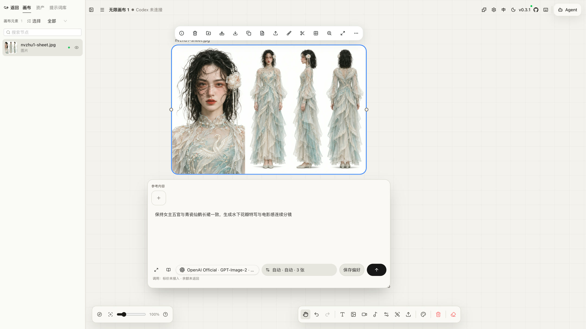

<div align="center">



# sig-dream · sig キャンバス

**データベース不要・ローカル完結・すぐ使えるオープンソース AI 無限キャンバス＆動画制作スタジオ**

AI 画像生成、マルチリファレンス編集、動画生成、1,700+ プロンプト集、Canvas Agent を 1 つの無限キャンバスに統合し、**脚本 / リメイク / 差し替え**の 3 つのスタジオを内蔵しています。  
PostgreSQL やログイン設定なしで、デスクトップ版またはポータブル版を起動し、API キーを入れるだけで 30 秒で始められます。

[](README.md)
[](README.en.md)
[](README.ja.md)
[](README.ko.md)

[](https://github.com/ChenShuo2004/sig-dream/releases/latest)
[](https://github.com/ChenShuo2004/sig-dream/stargazers)
[](LICENSE)

</div>

<br/>

<div align="center">
  <a href="docs/demos/00-open-source-launch.mp4">
    
  </a>
  <p>
    <sub>🎬 <a href="docs/demos/00-open-source-launch.mp4"><b>28秒 1080p 音声付きプロモーション動画（MP4）を再生</b></a></sub>
  </p>
</div>

| キャラクター一貫性＆連結コンテ | 100+ ノードのエピソード編成 |
| --- | --- |
|  |  |

## ダウンロード & クイックスタート

### 1. デスクトップアプリ（おすすめ・Node.js 不要）

[**GitHub Releases 最新版**](https://github.com/ChenShuo2004/sig-dream/releases/latest) から OS に合うインストーラーをダウンロードして起動するだけです：

- **macOS**：`sig-dream-*-mac-arm64.dmg`（Apple Silicon）/ `sig-dream-*-mac-x64.dmg`（Intel）
- **Windows**：`sig-dream-*-win-x64-setup.exe` / `sig-dream-*-win-x64.zip`
- **Linux**：`sig-dream-*-linux-x64.AppImage` / `.deb`

> [!TIP]
> コミュニティ版のインストーラーは未署名のため、初回起動時に警告が出た場合は macOS では `xattr -cr /Applications/sig-dream.app`、Windows では「詳細情報」→「実行」で起動できます。

### 2. Web ポータブル版（`npm install` 不要・Node.js 20+）

Releases から `sig-dream-*-web-portable.zip` をダウンロードして展開し、起動スクリプト（`启动-macOS.command` / `启动-Windows.bat` / `./start.sh`）を実行してください。

### 3. Docker Compose / ソースから起動

```bash
git clone https://github.com/ChenShuo2004/sig-dream.git
cd sig-dream

# Docker Compose
docker compose up -d

# または Node.js 20+ で開発起動
npm install
npm run dev
```

起動後、[http://localhost:3000](http://localhost:3000) を開き、右上の **⚙️ 設定** からモデルチャネル（Base URL と API Key）を登録してご利用ください。

## 機能デモ動画

以下のデモはオープンソース版の実画面からレンダリングされています（クリックすると `1080p` MP4 を開きます）：

| 01 · 初期設定＆マルチプロバイダー | 02 · 無限キャンバス編成 |
| --- | --- |
| [](docs/demos/01-overview-and-config.mp4) | [](docs/demos/02-infinite-canvas.mp4) |

| 03 · 脚本スタジオ | 04 · リメイク＆差し替えスタジオ |
| --- | --- |
| [](docs/demos/03-script-studio.mp4) | [](docs/demos/04-replication-and-replacement.mp4) |

| 05 · 1,700+ プロンプト集＆ローカルアセット | ノード参照編集 |
| --- | --- |
| [](docs/demos/05-prompts-and-assets.mp4) |  |

## 主な機能

- **無限キャンバス（`/canvas`）**：画像・動画・テキストノードの接続、グループ参照、マスク編集、Canvas Agent 連携。
- **3 つのスタジオ（`/studio/*`）**：脚本スタジオ（キャラ・背景・絵コンテ一括生成）、リメイクスタジオ、差し替えスタジオ。
- **1,700+ プロンプト集 & ローカルアセット（`/prompts`・`/assets`）**：すべてのデータと API キーはローカル IndexedDB / LocalStorage に保存され、JSON エクスポート / インポートや WebDAV 同期に対応。
- **内蔵ローカル CORS プロキシ（[`server/proxy.mjs`](server/proxy.mjs)）**：OpenAI 互換 / Gemini / DeepSeek / 火山エンジン（Seedance 2.0） / RunningHub などを追加バックエンドなしで利用可能。

## エンタープライズ版（クローズドソース）

本リポジトリは個人・ローカル利用向けの MIT オープンソース版です。チーム向け LAN NAS アセットライブラリ、権限管理・監査ログ、音声クローン/カバー制作スタジオなどは商用エンタープライズ版（非公開ソース）の機能となります。詳細は [README.en.md](README.en.md) または [@ChenshuoAI](https://x.com/ChenshuoAI) をご確認ください。

## ライセンス

[basketikun/infinite-canvas](https://github.com/basketikun/infinite-canvas)（MIT License）をベースに開発しています。元ライセンスは [LICENSE.upstream-infinite-canvas](LICENSE.upstream-infinite-canvas) に保持し、本プロジェクトは [MIT License](LICENSE) で公開しています。
