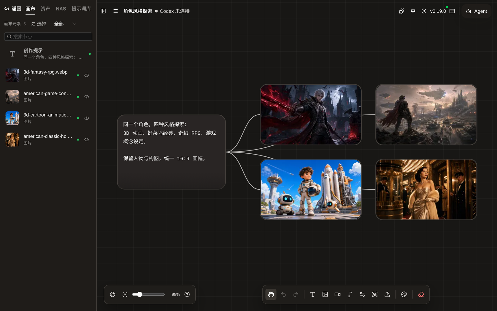
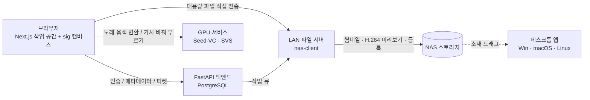
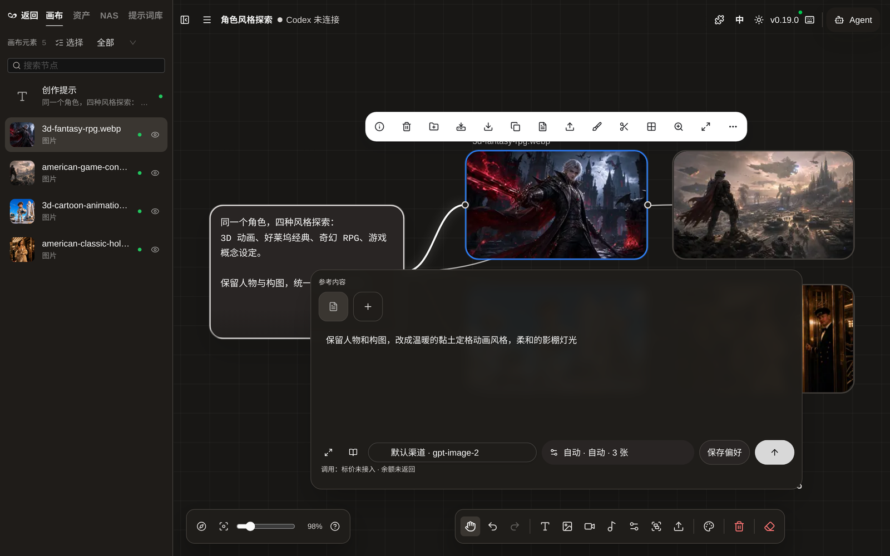
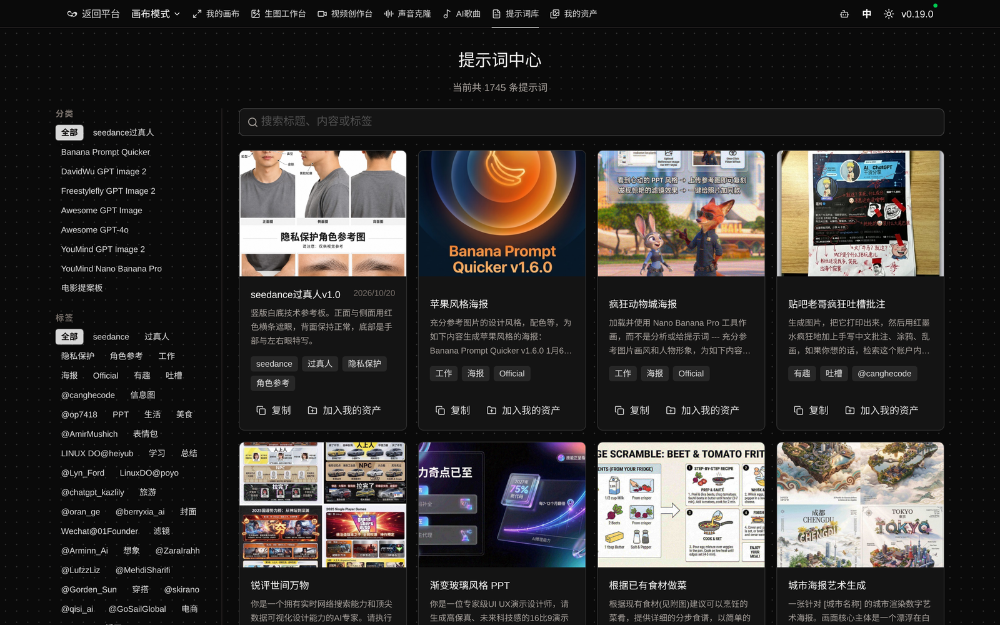
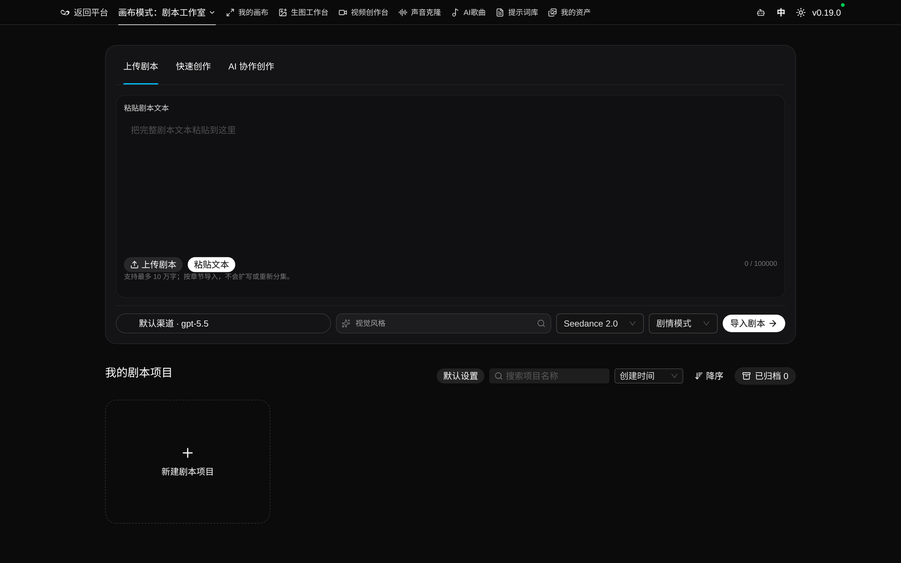
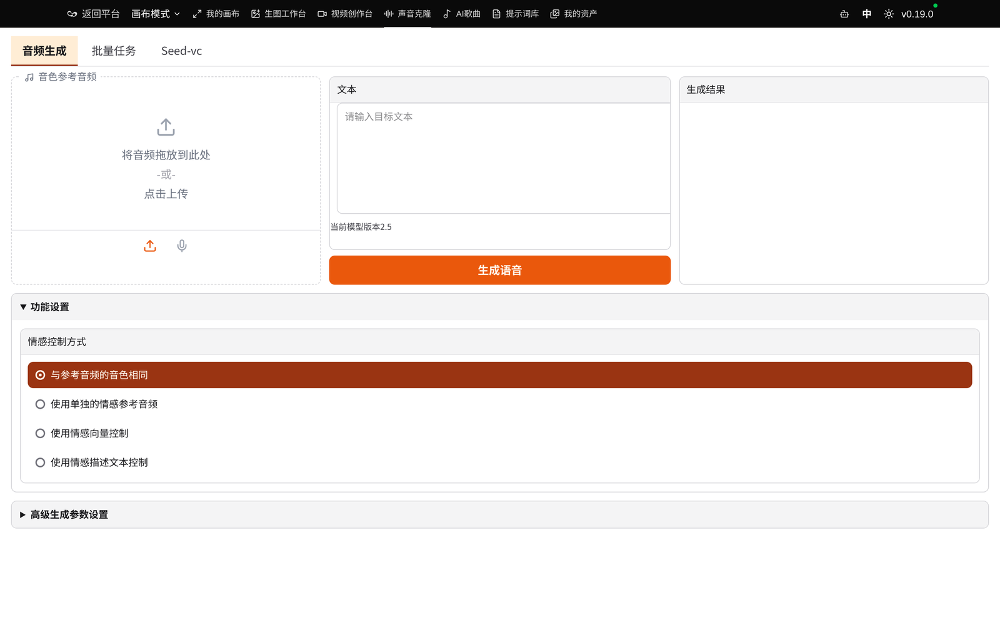
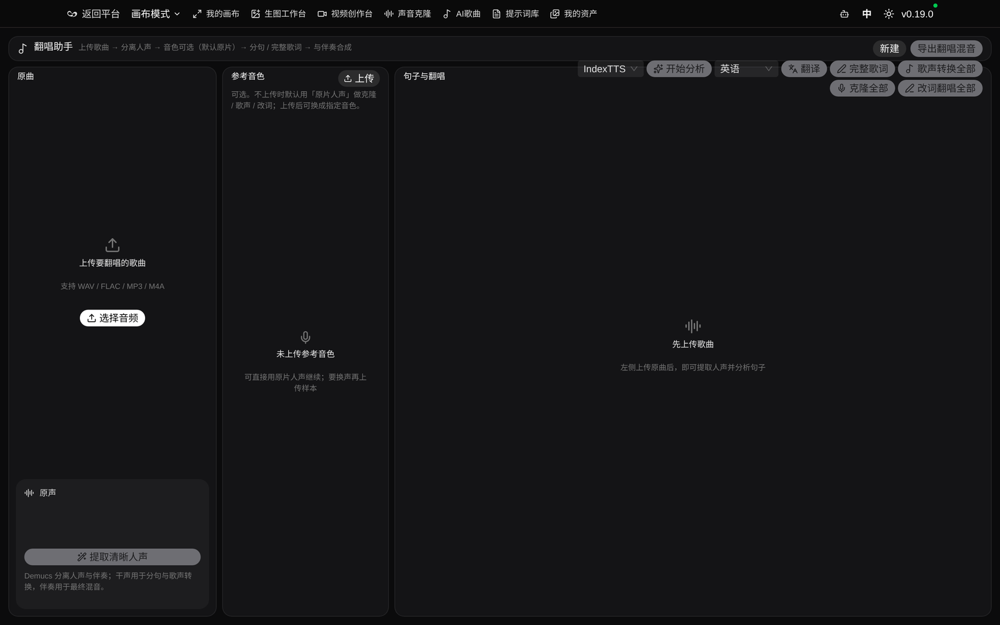
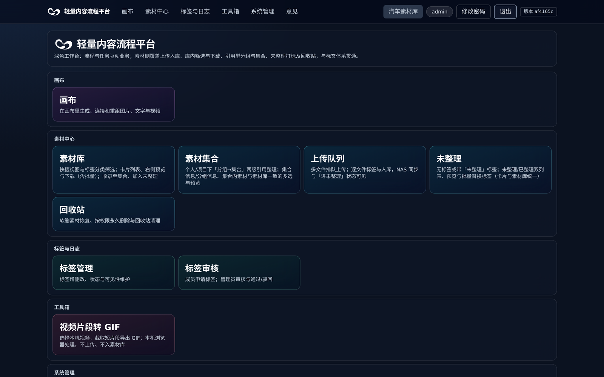
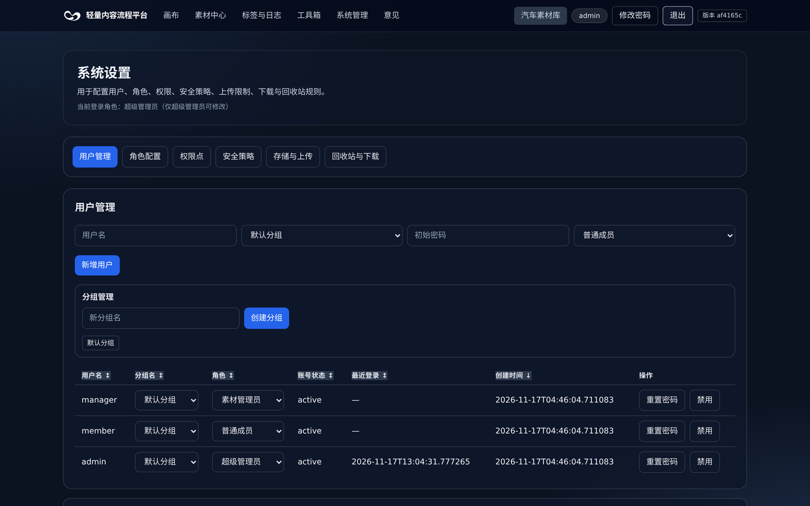

> **English:** A self-hosted AI creation canvas and asset workspace for content teams. [Read in English →](README.en.md)

[](README.md)
[](README.en.md)
[](README.ja.md)
[](README.ko.md)
[](https://x.com/ChenshuoAI)
[](https://github.com/ChenShuo2004/sig-dream/releases/latest)
[](LICENSE)

🚀 **[팀용 캔버스 배포하기](#설치)** · 💻 **[데스크톱 앱 다운로드](#데스크톱-앱)**

# sig-dream · sig 캔버스

**팀의 소재, 모델, 아이디어를 하나의 캔버스에.** 무한 캔버스 위에서 AI 이미지 생성, 참고 이미지 기반 편집, 동영상 생성, 내레이션, 노래 커버를 하나로 연결합니다. 캔버스에서 쓰는 모든 소재는 팀이 함께 쓰고 검색할 수 있으며 권한이 관리되는 소재 라이브러리에서 가져옵니다.

sig-dream은 콘텐츠 팀을 위한 셀프 호스팅 작업 공간입니다. 창작은 브라우저에서 하고, 인증·메타데이터·작업 관리는 FastAPI 백엔드가, 원본 저장과 썸네일·미리보기 생성은 LAN 안의 파일 서버가 맡습니다. 원본 파일이 클라우드를 거치지 않으므로 사무실 안에서는 LAN 속도로 업로드하고 다운로드할 수 있습니다.

> 현재 UI는 중국어만 지원합니다. 다른 언어로의 번역 기여를 환영합니다.





| 작업 공간 | 진입점 | 용도 |
| --- | --- | --- |
| **sig 캔버스** | `/canvas` | 무한 캔버스에서 이미지와 동영상을 생성·편집하고, Agent로 제작 흐름을 구성합니다. |
| **스튜디오** | 대본 / 재현 / 교체 | 대본에서 스토리보드까지, 참고 영상을 구간별로 재현, 영상 속 인물과 사물을 교체합니다. |
| **음성과 노래** | 내레이션 / 노래 / 커버 도우미 | 녹음하거나 업로드한 음성으로 내레이션을 만들고, 보컬과 반주를 분리해 가사를 바꾸고 원하는 음색으로 부르게 합니다. |
| **소재 라이브러리** | `/materials` | 팀 소재를 업로드, 태그, 정리, 검색, 다운로드합니다. 라이브러리 영역별로 분리됩니다. |


## 화면 미리보기

로컬에 새로 배포한 데모 환경에서 촬영했습니다. 캔버스 이미지는 저장소에 포함된 스타일 미리보기이며, 실제 업무 데이터나 키는 없습니다.

### 이미지를 선택해 편집

아무 노드나 선택하고 아래에 수정 내용을 입력한 뒤 모델과 장수를 고르면 바로 생성됩니다. 결과는 원본과 연결된 새 노드로 추가됩니다.



### 프롬프트 라이브러리

1,700개 이상의 오픈소스 프롬프트를 내장. 출처와 태그로 걸러 복사하거나 소재에 추가해 캔버스에서 다시 쓸 수 있습니다.



<details>
<summary>펼치기: 대본 스튜디오, 음성 복제, 커버 도우미, 팀 플랫폼</summary>

### 대본 스튜디오

대본을 붙여 넣거나 업로드하고 시각 스타일을 정한 뒤 캐릭터, 장면, 스토리보드로 나눕니다.



### 음성 복제

참고 음색을 업로드하고 텍스트를 입력하면 내레이션을 생성합니다. 참고 음성, 감정 벡터, 텍스트 설명으로 감정을 조절할 수 있습니다.



### 커버 도우미

원곡을 업로드해 보컬과 반주를 분리하고, 한 줄씩 가사를 바꿔 원하는 음색으로 변환한 뒤 원곡과 비교해 들을 수 있습니다.



### 팀 플랫폼 홈

소재 센터, 태그와 로그, 도구 상자, 시스템 관리를 하나의 작업 공간에.



### 시스템 설정

사용자, 그룹, 역할, 권한 항목을 한곳에서 관리하며 모든 쓰기 작업은 작업 로그에 남습니다.



</details>

## 설치

### 요구 사항

- Python 3.11 이상
- Node.js 20 이상
- PostgreSQL(로컬 또는 클라우드)
- FFmpeg와 FFprobe(`PATH`에 추가, 파일 서버의 썸네일·미리보기 생성에 필요)
- 선택: Seed-VC와 SVS 서비스용 NVIDIA GPU가 있는 Windows 컴퓨터
- 선택: 원본을 저장할 LAN 파일 서버 또는 NAS

저장소를 받습니다. 이후 명령은 모두 저장소 루트에서 실행합니다:

```bash
git clone https://github.com/ChenShuo2004/sig-dream.git
cd sig-dream
```

### 1. 백엔드

macOS/Linux:

```bash
cd backend
python3 -m venv .venv
.venv/bin/pip install -r requirements.txt
cp .env.example .env          # 데이터베이스 연결과 세 가지 시크릿 설정
.venv/bin/alembic upgrade head
.venv/bin/uvicorn app.main:app --host 127.0.0.1 --port 8000
```

Windows PowerShell:

```powershell
cd backend
python -m venv .venv
.\.venv\Scripts\pip install -r requirements.txt
Copy-Item .env.example .env   # 데이터베이스 연결과 세 가지 시크릿 설정
.\.venv\Scripts\alembic upgrade head
.\.venv\Scripts\uvicorn app.main:app --host 127.0.0.1 --port 8000
```

`.env`에서 최소한 `DATABASE_URL`, `TOKEN_SECRET`, `NAS_CLIENT_TOKEN`, `DOWNLOAD_TICKET_SECRET`을 바꿔 주세요. 실행 후 `http://127.0.0.1:8000/health`에서 서비스 상태를 확인할 수 있습니다.

### 2. sig 캔버스 빌드

캔버스는 독립된 Vite 앱입니다. 빌드 결과는 `frontend/public/canvas-app`에 바로 출력되며, 작업 공간이 iframe으로 불러옵니다:

```bash
cd canvas-app/web
npm ci
npm run build
```

### 3. 웹 작업 공간

```bash
cd frontend
npm ci
npm run dev
```

[http://127.0.0.1:3000/](http://127.0.0.1:3000/)을 엽니다. 프런트엔드는 같은 출처의 `/api-proxy`를 통해 백엔드로 요청을 전달하며, 기본 백엔드 주소는 `http://127.0.0.1:8000`입니다. 바꾸려면 `frontend/.env.local.example`을 참고해 `NEXT_PUBLIC_API_BASE_URL`을 설정하세요.

운영 환경에서는 `npm run build && npm run start`를 실행하고 Nginx로 `3000` 포트에 리버스 프록시합니다. 서버 배포 절차(중국어)는 [백엔드 배포 가이드](docs/后端部署指南_V1_Ubuntu22.04.md)와 [배포 및 환경 변수](docs/PROJECT_CONTEXT/07_部署与环境变量.md)를 참고하세요.

### 4. 파일 서버(선택)

원본, 썸네일, 미리보기 동영상은 LAN 파일 서버의 `nas-client`가 처리합니다. 파일 서버에서:

```powershell
cd nas-client
python -m venv .venv
.\.venv\Scripts\pip install -r requirements.txt
Copy-Item nas-client-token.txt.example nas-client-token.txt   # 백엔드와 같은 NAS_CLIENT_TOKEN 입력
Copy-Item ecs-api-url.txt.example ecs-api-url.txt             # 백엔드 주소 입력
```

그런 다음 저장소 루트에서 `start-nas-direct-services.bat`을 실행하면 다운로드 서버와 작업 워커가 함께 시작됩니다. 파일 서버가 없어도 로그인, 캔버스, 메타데이터 관리는 쓸 수 있지만 소재 등록과 미리보기 생성은 실행되지 않습니다.

### 5. GPU 서비스(선택)

커버 도우미는 로컬 GPU 서비스 두 개를 사용합니다. 각 폴더를 GPU 컴퓨터에 복사한 뒤 `start.bat`을 더블클릭하세요:

| 서비스 | 폴더 | 포트 | 역할 |
| --- | --- | --- | --- |
| Seed-VC | `seed-vc-service/` | `7865` | 제로샷 노래·말소리 음색 변환(학습 불필요) |
| SVS | `svs-service/` | `7866` | 새 가사의 가이드 보컬을 원곡 멜로디에 맞춰 생성 |

### 첫 로그인

데이터베이스 마이그레이션이 초기 최고 관리자(사용자 이름 `admin`, 비밀번호 `admin123`)를 만듭니다.

> ⚠️ **로그인한 즉시 「시스템 설정 → 사용자」에서 비밀번호를 바꾸세요.** 또는 본인의 관리자 계정을 만든 뒤 이 계정을 비활성화하세요. 공개 배포에서는 기본 비밀번호를 그대로 두지 마세요.

캔버스는 「소재 관리자」와 「최고 관리자」 역할에서 사용할 수 있습니다. 다른 구성원에게는 시스템 설정의 권한 항목으로 부여하세요.

## 데스크톱 앱

데스크톱 앱은 Windows, macOS, Linux를 지원합니다. 팀 서버에 로그인해 소재 라이브러리와 컬렉션을 둘러보고, 캔버스를 열고, 소재를 편집 프로그램으로 바로 끌어다 놓을 수 있습니다. [Releases](https://github.com/ChenShuo2004/sig-dream/releases/latest)에서 운영체제에 맞는 설치 파일을 받으세요:

| 운영체제 | 설치 파일 | 비고 |
| --- | --- | --- |
| **Windows 10/11** | `sig-dream-<버전>-win-x64-setup.exe` | 설치형. 설치 없이 쓰는 `.zip`도 있습니다 |
| **macOS(Apple 실리콘)** | `sig-dream-<버전>-mac-arm64.dmg` | M1 / M2 / M3 / M4 등 |
| **macOS(Intel)** | `sig-dream-<버전>-mac-x64.dmg` | Intel 프로세서 Mac |
| **Linux** | `sig-dream-<버전>-linux-x86_64.AppImage` | 범용 형식. Debian / Ubuntu용 `.deb`도 있습니다 |

처음 실행하면 로그인 화면의 **服务器地址(서버 주소)** 에 팀 웹사이트 주소(브라우저로 접속하는 주소와 같음)를 입력해 저장한 뒤 로그인하세요. 주소는 내 컴퓨터에만 저장되며, 설치 파일에는 서버 주소나 인증 정보가 들어 있지 않습니다.

설치 파일은 아직 코드 서명이 되어 있지 않아 처음 실행할 때 시스템이 막을 수 있습니다:

- **Windows**: 「Windows의 PC 보호」 창이 나오면 **추가 정보 → 실행**을 누르세요.
- **macOS**: 「손상되었습니다」 또는 「개발자를 확인할 수 없습니다」가 나오면 앱을 「응용 프로그램」으로 옮긴 뒤 한 번 실행하세요:

  ```bash
  xattr -cr /Applications/sig-dream.app
  ```

- **Linux**: AppImage에 실행 권한을 먼저 주세요:

  ```bash
  chmod +x sig-dream-*-linux-x86_64.AppImage
  ```

앱은 GitHub Releases의 새 버전을 자동으로 확인하며, 설정 화면에서 직접 확인할 수도 있습니다. 소스에서 실행하거나 패키징하는 방법은 [desktop-client/README.md](desktop-client/README.md)를 참고하세요.

## 주요 기능

| 기능 | 설명 |
| --- | --- |
| 무한 캔버스 | 이미지·동영상·텍스트·오디오 노드를 자유롭게 연결합니다. 그룹, 다중 선택, 그룹 전체를 생성 입력으로 사용할 수 있습니다. |
| AI 이미지 생성과 편집 | OpenAI / Gemini API 생태계와 호환. 여러 참고 이미지 편집, 부분 마스크 주석, 1K / 2K / 4K 크기. |
| 동영상 생성 | 첫·마지막 프레임 모드와 전체 참조 모드. 페이지를 새로 고쳐도 원격 작업 상태를 이어서 확인하고, 동영상에서 첫·마지막·현재 프레임을 추출합니다. |
| Canvas Agent | Agent가 캔버스 노드를 직접 읽고 씁니다. Codex 같은 외부 Agent와도 함께 작업할 수 있습니다. |
| 대본 스튜디오 | 시각 스타일을 통일하고 캐릭터, 장면, 소품, 스토리보드를 계획합니다. |
| 재현 스튜디오 | 참고 영상을 구간별로 재현합니다. 검토, 의견 반영 수정, 구간별 재생성을 지원합니다. |
| 교체 스튜디오 | 이미지와 동영상 속 인물이나 사물을 교체합니다. 이미지용과 동영상용 모델을 따로 고를 수 있습니다. |
| 내레이션과 커버 | 참고 음성을 녹음하거나 업로드해 내레이션을 만들고, 보컬과 반주를 분리해 한 줄씩 가사를 바꾸고 원곡과 비교해 들을 수 있습니다. |
| 프롬프트 라이브러리 | 여러 오픈소스 프롬프트 모음을 내장. 소재에 추가해 캔버스에서 다시 쓸 수 있습니다. |
| 두 개의 라이브러리 영역 | 한 플랫폼 안의 독립된 소재 라이브러리 두 개. 목록, 태그, 미정리, 업로드, 컬렉션이 섞이지 않습니다. |
| 태그와 정리 | 동적 태그 분류, 태그 교체와 심사. 태그가 없거나 「미정리」 태그가 붙은 소재를 모아서 처리합니다. |
| 컬렉션 | 참조 방식으로 소재를 정리합니다. 파일을 복사하지 않고 원본 위치도 바뀌지 않습니다. |
| LAN 우선 전송 | 다운로드는 LAN 파일 서버 → WAN 파일 서버 → 서버 캐시 순서. 대용량 파일은 나눠 올리고 검증합니다. |
| 썸네일과 미리보기 | 파일 서버가 썸네일과 H.264 미리보기 MP4를 비동기로 생성해 서버에 변환 부담을 주지 않습니다. |
| 역할과 권한 | 역할-권한 매트릭스로 통합 관리. 모든 쓰기 작업을 작업 로그에 남겨 사용자별로 감사할 수 있습니다. |
| 튜토리얼 | 페이지 안의 대화형 안내로 구성원별 진행 상황을 기록합니다. |
| 데스크톱 앱 | Windows / macOS / Linux 지원. 소재를 편집 프로그램으로 끌어다 놓을 수 있고, GitHub Releases에서 자동 업데이트됩니다. |

## 사용 팁

### 캔버스에서 시작하기

캔버스 오른쪽 위 설정에서 모델 채널(Base URL과 API 키)을 추가하고 연결 테스트에 성공하면 바로 생성할 수 있습니다. 키는 브라우저에만 저장되며, 설정 파일을 내보내 팀에 공유할 수도 있습니다.

### 소재에서 시작하기

`/materials/upload`에서 소재를 업로드하고, 등록이 끝나면 「미정리」 페이지에서 한꺼번에 태그를 붙입니다. 정리한 소재는 컬렉션에 넣거나 캔버스에서 참고 이미지로 바로 쓸 수 있습니다.

### 노래 한 곡에서 시작하기

커버 도우미를 열고 원곡을 업로드하면 보컬과 반주가 자동으로 분리됩니다. 한 줄씩 새 가사를 입력하고 참고 음색을 고르면 가이드 보컬이 Seed-VC로 그 음색에 맞게 바뀌며, 줄마다 원곡과 비교해 들을 수 있습니다.

## 실행과 데이터

| 데이터 | 저장 위치 |
| --- | --- |
| 사용자, 권한, 소재 메타데이터, 작업, 로그 | PostgreSQL |
| 원본 파일, 썸네일, 미리보기 동영상 | 파일 서버 / NAS(`NAS_MOUNT_ROOT`) |
| 캔버스 프로젝트, 생성 이미지, 모델 설정 | 브라우저 IndexedDB(WebDAV 동기화 선택 가능) |

`.env*`, 파일 서버 토큰, NAS 인증 정보, 가상 환경, `node_modules`, 로컬 데이터베이스 백업은 모두 Git에서 제외되며, 저장소에는 `*.example` 템플릿만 들어 있습니다. API 키, 데이터베이스 연결 문자열, 내부 주소를 Issue, 로그, 스크린샷, 커밋에 올리지 마세요.

## 개발 검증

```bash
# sig 캔버스: 타입 검사와 단위 테스트
(cd canvas-app/web && npm run typecheck && npm test)

# 웹 작업 공간: 프로덕션 빌드
(cd frontend && npm run build)

# 데스크톱 앱: 화면 빌드(설치 파일은 GitHub Actions가 빌드)
(cd desktop-client && npm run build)

# 파일 서버: 썸네일과 인물 인식 파이프라인 테스트
(cd nas-client && python test_studio_media.py && python test_person_pipeline.py)
```

데이터베이스 구조를 바꿀 때는 기존 마이그레이션을 고치지 말고 새 Alembic 마이그레이션을 추가하세요.

## 프로젝트 구조

```text
├── backend/              # FastAPI 백엔드: 인증, 소재, 태그, 컬렉션, 캔버스, 스튜디오 API
├── frontend/             # Next.js 작업 공간: 소재 라이브러리, 시스템 설정, 튜토리얼, sig 캔버스 내장
├── canvas-app/           # sig 캔버스(infinite-canvas 기반 Vite 앱)
├── desktop-client/       # Electron 데스크톱 앱(Windows / macOS / Linux)
├── nas-client/           # 파일 서버: 다운로드 서버, 작업 워커, 썸네일과 미리보기 변환
├── seed-vc-service/      # Seed-VC 노래 음색 변환 서비스
├── svs-service/          # SVS 가사 바꿔 부르기 가이드 보컬 서비스
├── docs/                 # 개발 과정, 배포 가이드, 태그 설명. archive/에 과정 문서 보관
├── docs/PROJECT_CONTEXT/ # 아키텍처, 모듈, 데이터베이스, API, 배포 문서(중국어)
├── scripts/ · tools/     # 데이터베이스 백업, 미리보기 재생성 등 운영 스크립트
└── deploy.sh             # 서버 측 원스텝 배포 스크립트
```

프로젝트가 어떻게 만들어졌는지는 [개발 과정](docs/开发历程.md)(중국어)에 정리되어 있습니다. 구현을 자세히 알고 싶다면 [프로젝트 개요](docs/PROJECT_CONTEXT/00_项目总览.md)와 [시스템 아키텍처](docs/PROJECT_CONTEXT/01_系统架构.md)(중국어)부터 읽어 보세요.

## 감사의 말

sig 캔버스는 [basketikun/infinite-canvas](https://github.com/basketikun/infinite-canvas)(MIT License)를 바탕으로 개발했습니다. 무한 캔버스, 이미지 생성, 동영상, Agent 기능 위에 스튜디오, 내레이션, 노래, 커버 도우미를 더하고 팀 소재 라이브러리와 계정 권한에 연결했습니다. 원래 라이선스는 [canvas-app/LICENSE](canvas-app/LICENSE)에 그대로 두었습니다.

[ComfyUI](https://github.com/comfyanonymous/ComfyUI), [Seed-VC](https://github.com/Plachtaa/seed-vc), [Bootstrap Icons](https://github.com/twbs/icons), 그리고 모든 오픈소스 프롬프트 모음의 작성자에게 감사드립니다.

## Star 추이

[](https://star-history.com/#ChenShuo2004/sig-dream&Date)

## 기여하기

Issue와 Pull Request를 환영합니다. 수정하기 전에 [핵심 설계 결정](docs/PROJECT_CONTEXT/09_关键设计决策.md)을 읽어 주세요. 라이브러리 영역 분리, 컬렉션의 참조 의미, LAN 우선 전송, 권한 항목 검사에는 명확한 제약이 있습니다. 데이터를 쓰는 엔드포인트에는 작업 로그 기록도 함께 추가해 주세요.

## 라이선스

이 프로젝트는 [MIT License](LICENSE)로 배포됩니다. `canvas-app/`의 infinite-canvas 유래 코드는 원래의 [MIT License](canvas-app/LICENSE)도 함께 따릅니다.
