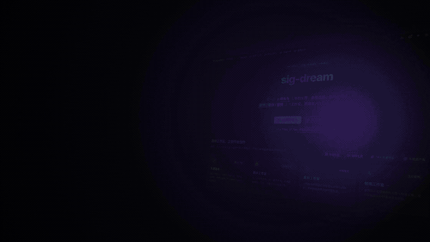
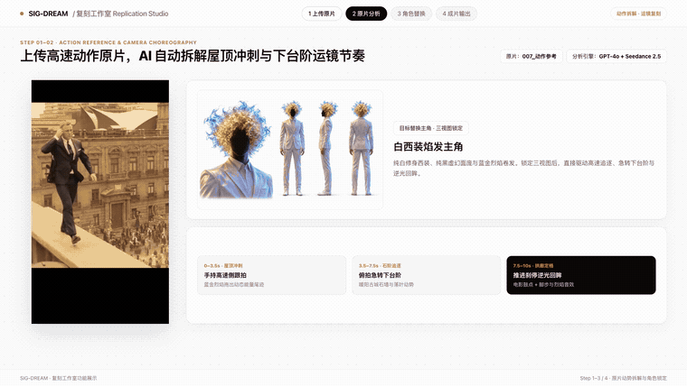

<div align="center">


# sig-dream

**데이터베이스 없이 바로 실행하는 로컬 우선 오픈소스 AI 무한 캔버스 & 영상 스튜디오**

AI 이미지 생성, 다중 참조 편집, 영상 생성, 34+ 내장 크리에이티브·모션 Skill, 8대 MCP Canvas Agent를 하나의 무한 캔버스에 통합하고 **대본 / 복제 / 교체** 3대 스튜디오를 내장했습니다.  
PostgreSQL이나 로그인 없이 데스크톱 앱 또는 포터블 패키지를 실행하고 API 키만 입력하면 30초 만에 시작할 수 있습니다.

[](README.md)
[](README.en.md)
[](README.ja.md)
[](README.ko.md)

[](https://github.com/ChenShuo2004/sig-dream/releases/latest)
[](https://github.com/ChenShuo2004/sig-dream/stargazers)
[](LICENSE)

</div>

<br/>

<div align="center">
  <a href="docs/demos/00-fast-hype-promo.mp4">
    
  </a>
  <p>
    <sub>
      🎬 <b>30초 3D 프로모션 영상</b> ·
      <a href="https://github.com/ChenShuo2004/sig-dream/raw/main/docs/demos/00-fast-hype-promo.mp4"><b>1080p MP4 다운로드</b></a> ·
      <a href="docs/demos/00-fast-hype-promo.mp4"><b>저장소 파일</b></a>
    </sub>
  </p>
</div>

### 3대 스튜디오 실전 결과 미리보기 (클릭 시 1080p 음성 MP4 재생)

| 🎬 대본 스튜디오 | ⚡ 복제 스튜디오 | 🎭 교체 스튜디오 |
| --- | --- | --- |
| [](docs/demos/03-script-studio.mp4)<br/><sub>대본 → 2K 설정 시트 → 16컷 영상 생성 · [1080p MP4](docs/demos/03-script-studio.mp4)</sub> | [](docs/demos/04-replication-studio.mp4)<br/><sub>모션 분석 → 새 캐릭터 교체 → 16:9 액션 · [1080p MP4](docs/demos/04-replication-studio.mp4)</sub> | [](docs/demos/06-replacement-studio.mp4)<br/><sub>원본 영상 ⇄ 인물·음성 동시 교체 비교 · [1080p MP4](docs/demos/06-replacement-studio.mp4)</sub> |

## 다운로드 & 빠른 시작

### 1. 데스크톱 앱 다운로드 (추천 · Node.js 불필요)

[**GitHub Releases 최신 버전**](https://github.com/ChenShuo2004/sig-dream/releases/latest) 에서 운영체제에 맞는 설치 파일을 받아 바로 실행하세요:

- **macOS**: `sig-dream-*-mac-arm64.dmg` (Apple Silicon) / `sig-dream-*-mac-x64.dmg` (Intel)
- **Windows**: `sig-dream-*-win-x64-setup.exe` / `sig-dream-*-win-x64.zip`
- **Linux**: `sig-dream-*-linux-x64.AppImage` / `.deb`

> [!TIP]
> 커뮤니티 설치 파일은 코드 서명이 되어 있지 않습니다. 첫 실행 시 경고가 표시되면 macOS에서는 `xattr -cr /Applications/sig-dream.app`, Windows에서는「추가 정보」→「실행」을 선택하세요.

### 2. 웹 포터블 패키지 (`npm install` 불필요 · Node.js 20+)

Releases에서 `sig-dream-*-web-portable.zip`을 받아 압축을 풀고 실행 스크립트(`启动-macOS.command` / `启动-Windows.bat` / `./start.sh`)를 실행하세요.

### 3. Docker Compose / 소스 실행

```bash
git clone https://github.com/ChenShuo2004/sig-dream.git
cd sig-dream

# Docker Compose
docker compose up -d

# 또는 Node.js 20+ 개발 실행
npm install
npm run dev
```

[http://localhost:3000](http://localhost:3000) 을 열고 우측 상단 **⚙️ 설정**에서 모델 채널(Base URL + API Key)을 입력하세요.

## 기능 데모 영상

<div align="center">
  <picture>
    <source media="(prefers-color-scheme: dark)" srcset="docs/screenshots/home-overview-dark.jpg" />
    <source media="(prefers-color-scheme: light)" srcset="docs/screenshots/home-overview-light.jpg" />
    
  </picture>
  <p>
    <sub><b>sig-dream 홈 화면</b>: 무한 캔버스, 대본 / 복제 / 교체 3대 스튜디오, 34+ 내장 Skill 센터, 로컬 자산 허브 (라이트 / 다크 테마 지원)</sub>
  </p>
</div>

아래 데모는 오픈소스 커뮤니티 에디션 실제 화면에서 렌더링되었습니다 (클릭하면 `1080p` MP4 원본을 볼 수 있습니다):

| 01 · 무설치 시작 & 멀티 채널 설정 | 02 · 무한 캔버스 노드 오케스트레이션 |
| --- | --- |
| [](docs/demos/01-overview-and-config.mp4) | [](docs/demos/02-infinite-canvas.mp4) |

| 03 · 대본 스튜디오 | 04 · 복제 & 교체 스튜디오 |
| --- | --- |
| [](docs/demos/03-script-studio.mp4) | [](docs/demos/04-replication-and-replacement.mp4) |

| 05 · 34+ 내장 창작 & 모션 Skill 센터 | 노드 참조 편집 |
| --- | --- |
|  |  |

## 주요 기능

- **무한 캔버스 (`/canvas`)**: 이미지·영상·텍스트 노드 연결, 그룹 참조, 마스크 편집, Canvas Agent 협업.
- **3대 스튜디오 (`/studio/*`)**: 대본 스튜디오(캐릭터/배경/스토리보드 생성), 복제 스튜디오, 교체 스튜디오.
- **34+ 내장 Skill 센터 & 로컬 자산 (`/skills`, `/assets`)**: 창작 워크플로우, 해부학/스토리보드 기법 및 18개 모션·3D 엔진 Skill을 `.agents/skills/`에 기본 내장. 모든 데이터와 API 키는 로컬 IndexedDB에 안전하게 보관됩니다.
- **내장 로컬 CORS 프록시 ([`server/proxy.mjs`](server/proxy.mjs))**: OpenAI 호환 / Gemini / DeepSeek / Volcengine (Seedance 2.0) / RunningHub 등을 별도 백엔드 없이 바로 호출할 수 있습니다.

## 엔터프라이즈 에디션 (비공개 상용)

이 저장소는 개인 및 로컬 워크플로우용 MIT 오픈소스 커뮤니티 에디션입니다. 팀용 LAN NAS 자산 허브, 역할 기반 권한 및 감사 로그, 음성 클로닝/커버 스튜디오는 비공개 상용 엔터프라이즈 에디션에 포함됩니다. 자세한 내용은 [README.en.md](README.en.md) 또는 [@ChenshuoAI](https://x.com/ChenshuoAI) 를 참고하세요.

## 라이선스

[basketikun/infinite-canvas](https://github.com/basketikun/infinite-canvas)(MIT License)를 기반으로 확장 개발했습니다. 원본 라이선스는 [LICENSE.upstream-infinite-canvas](LICENSE.upstream-infinite-canvas)에 보존되며, 본 프로젝트는 [MIT License](LICENSE)를 따릅니다.
