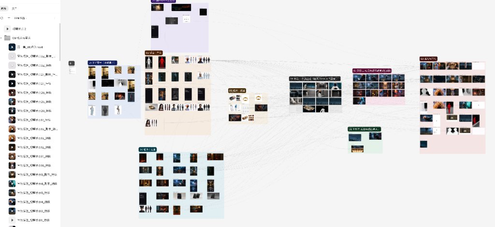
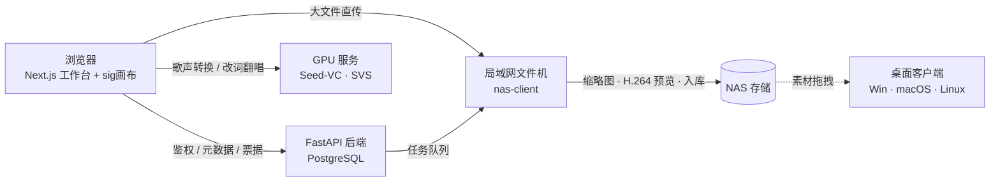
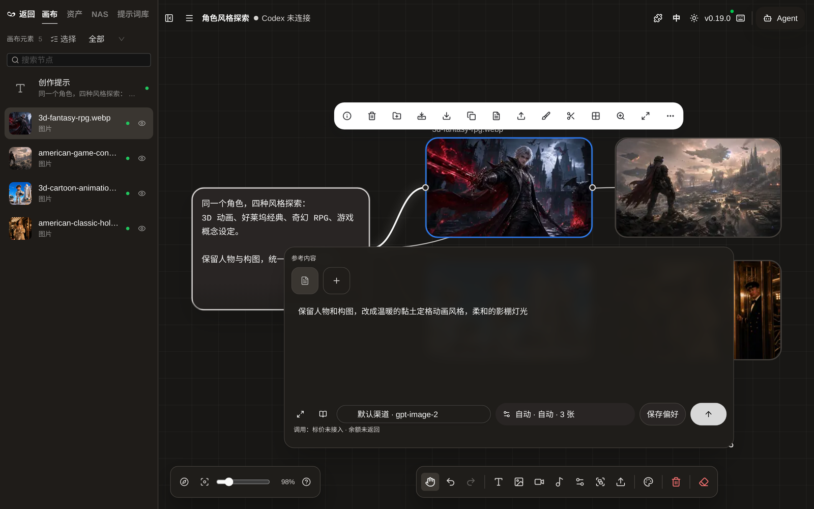
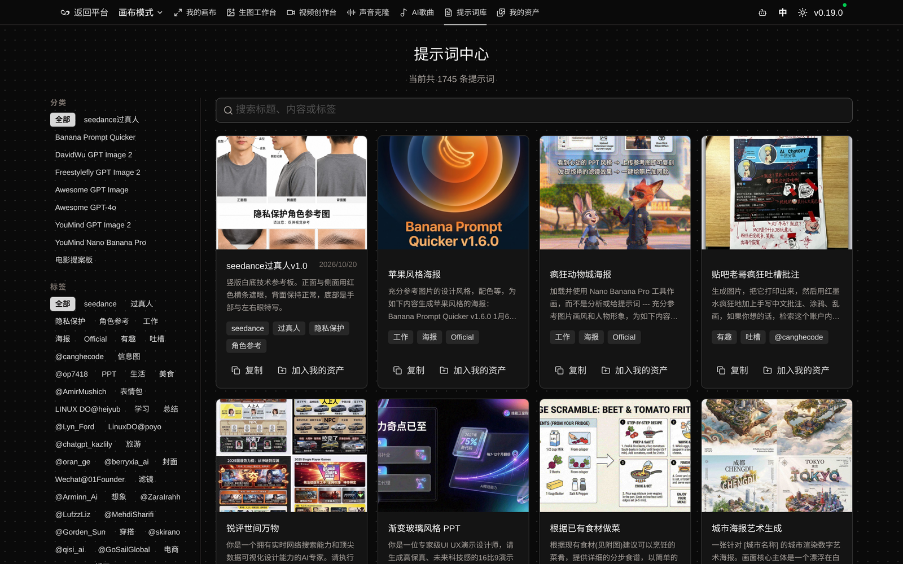
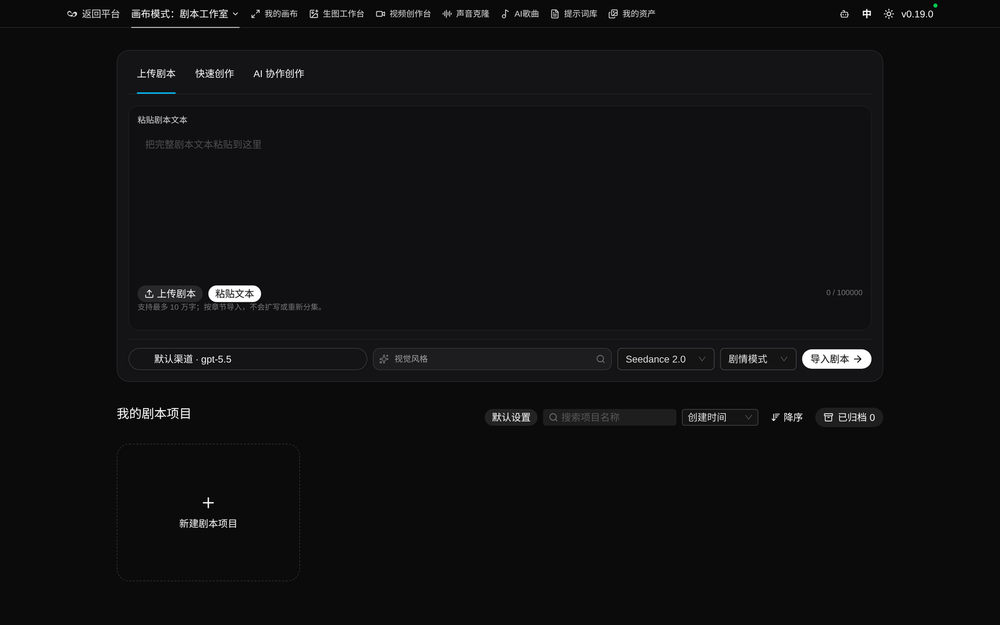
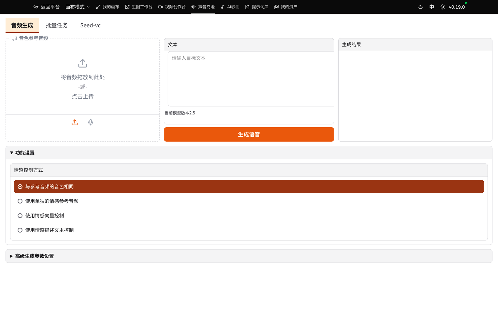
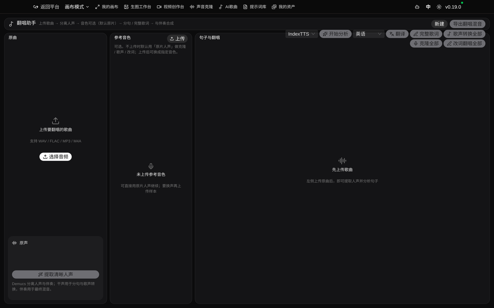
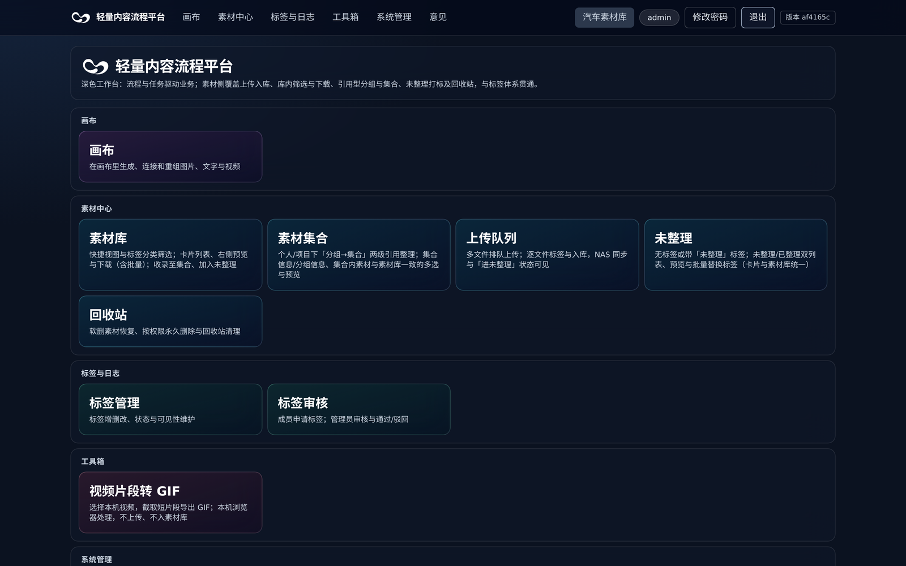
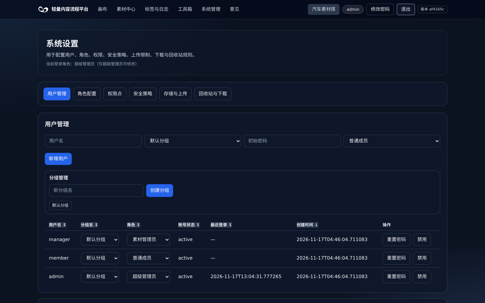

[](README.md)
[](README.en.md)
[](README.ja.md)
[](README.ko.md)
[](https://x.com/ChenshuoAI)
[](https://github.com/ChenShuo2004/sig-dream/releases/latest)
[](LICENSE)

🚀 **[局域网版本部署](docs/局域网部署指南.md)** · 💻 **[下载桌面端](#桌面客户端)** · 🖥️ **[服务器部署](#安装)** · 🌐 **[English](README.en.md)**

# sig-dream · sig画布

**把团队的素材、模型和创意，放进同一张画布。** 在无限画布上串起 AI 生图、参考图编辑、视频生成、配音与翻唱；画布用到的每一份素材，都来自团队共用、可检索、有权限管理的素材库。

提供 **局域网版本**（办公室主机 + 局域网文件机直传，不依赖云服务器，素材原件不出内网）与 **三端桌面客户端**（Windows / macOS / Linux，支持直接把素材拖进剪辑软件），也可按需部署到独立 Linux 服务器。





| 工作区 | 入口 | 适合做什么 |
| --- | --- | --- |
| **sig画布** | `/canvas` | 在无限画布上生图、改图、生视频，用 Agent 编排创作流程。 |
| **工作室** | 剧本 / 复刻 / 替换 | 从剧本到分镜、按参考视频逐段复刻、替换画面中的人物与物体。 |
| **声音与歌曲** | 配音 / 歌曲 / 翻唱助手 | 录制或上传音频生成配音，分离人声伴奏，改词翻唱并换成指定音色。 |
| **素材库** | `/materials` | 上传、打标签、整理、检索和下载团队素材，按素材库域隔离。 |


## 界面预览

截图来自本地全新部署的演示环境：画布中的图片是仓库自带的风格预览图，未包含任何真实业务数据或密钥。

### 选中图片即可改图

选中任意节点，在下方输入修改要求，选择模型与张数后直接生成；生成结果会作为新节点连回原图。



### 提示词库

内置 1700+ 条开源提示词，按来源与标签筛选，一键复制或加入资产后在画布中复用。



<details>
<summary>展开查看：剧本工作室、声音克隆、翻唱助手与团队平台</summary>

### 剧本工作室

粘贴或上传剧本，统一视觉风格后拆分角色、场景与分镜。



### 声音克隆

上传参考音色，输入文本即可生成配音，可按参考音频、情感向量或文字描述控制情感。



### 翻唱助手

上传原曲后分离人声与伴奏，逐句改词并换成指定音色，与原声对比试听。



### 团队平台首页

素材中心、标签与日志、工具箱和系统管理集中在一个工作台。



### 系统设置

用户、分组、角色与权限点统一管理，所有写操作都会记录操作日志。



</details>

## 安装

### 环境要求

- Python 3.11+
- Node.js 20+
- PostgreSQL（本地或云数据库均可）
- FFmpeg 与 FFprobe，且已加入系统 `PATH`（文件机生成缩略图与预览需要）
- 可选：一台带 NVIDIA GPU 的 Windows 机器，用于 Seed-VC 歌声转换与 SVS 改词翻唱服务
- 可选：一台局域网文件机或 NAS，用于存放素材原件

先取得项目代码，后续命令均在仓库根目录运行：

```bash
git clone https://github.com/ChenShuo2004/sig-dream.git
cd sig-dream
```

### 1. 后端

macOS/Linux：

```bash
cd backend
python3 -m venv .venv
.venv/bin/pip install -r requirements.txt
cp .env.example .env          # 修改数据库连接与三个密钥
.venv/bin/alembic upgrade head
.venv/bin/uvicorn app.main:app --host 127.0.0.1 --port 8000
```

Windows PowerShell：

```powershell
cd backend
python -m venv .venv
.\.venv\Scripts\pip install -r requirements.txt
Copy-Item .env.example .env   # 修改数据库连接与三个密钥
.\.venv\Scripts\alembic upgrade head
.\.venv\Scripts\uvicorn app.main:app --host 127.0.0.1 --port 8000
```

`.env` 中至少需要改掉 `DATABASE_URL`、`TOKEN_SECRET`、`NAS_CLIENT_TOKEN` 和 `DOWNLOAD_TICKET_SECRET`。启动后访问 `http://127.0.0.1:8000/health` 确认服务正常。

### 2. 构建 sig画布

画布是独立的 Vite 应用，仓库已附带构建产物；如需从源码重新构建（输出到 `frontend/public/canvas-app`）：

```bash
cd canvas-app/web
npm ci --legacy-peer-deps
npm run build
```

### 3. 前端工作台

```bash
cd frontend
npm ci
npm run dev
```

打开 [http://127.0.0.1:3000/](http://127.0.0.1:3000/)。前端会通过同源的 `/api-proxy` 转发到后端，默认后端地址为 `http://127.0.0.1:8000`；如需修改，参考 `frontend/.env.local.example` 设置 `NEXT_PUBLIC_API_BASE_URL`。

- **办公室局域网使用（局域网版本）**：无需云服务器，按 [局域网部署指南](docs/局域网部署指南.md) 监听 `0.0.0.0` 即可供局域网浏览器与桌面端访问。
- **公网 / Linux 服务器部署**：使用 `npm run build && npm run start` 并配 Nginx 反向代理到 `3000` 端口，完整步骤见 [服务器部署指南](docs/服务器部署指南.md)。

### 4. 文件机（可选）

素材原件、缩略图与预览视频由局域网文件机上的 `nas-client` 处理。在文件机上：

```powershell
cd nas-client
python -m venv .venv
.\.venv\Scripts\pip install -r requirements.txt
Copy-Item nas-client-token.txt.example nas-client-token.txt   # 填入与后端相同的 NAS_CLIENT_TOKEN
Copy-Item ecs-api-url.txt.example ecs-api-url.txt             # 填入后端地址
```

然后在仓库根目录运行 `start-nas-direct-services.bat`，会同时启动下载服务与任务 Worker。没有文件机时，平台仍可登录、使用画布和管理元数据，但上传入库与预览生成不会执行。

### 5. GPU 服务（可选）

翻唱助手依赖两项本地 GPU 服务，复制到 GPU 机器后双击 `start.bat` 即可：

| 服务 | 目录 | 端口 | 作用 |
| --- | --- | --- | --- |
| Seed-VC | `seed-vc-service/` | `7865` | 零样本歌声 / 语音音色转换，无需训练 |
| SVS | `svs-service/` | `7866` | 按新歌词生成导唱，并贴合原曲旋律 |

### 首次登录

数据库迁移会创建一个初始超级管理员：账号 `admin`，密码 `admin123`。

> ⚠️ **登录后请立即在「系统设置 → 用户」中修改密码**，或新建自己的管理员后停用该账号。公网部署时不要保留默认密码。

画布仅对「素材管理员」和「超级管理员」角色开放；其他成员可在系统设置中按权限点授权。

## 桌面客户端

桌面客户端提供 Windows、macOS 和 Linux 三个版本，可以登录团队服务器浏览素材库与集合、打开画布，并把素材直接拖进剪辑软件。在 [Releases](https://github.com/ChenShuo2004/sig-dream/releases/latest) 下载对应安装包：

| 系统 | 安装包 | 说明 |
| --- | --- | --- |
| **Windows 10/11** | `sig-dream-<版本>-win-x64-setup.exe` | 安装版；另有 `.zip` 免安装版 |
| **macOS（Apple 芯片）** | `sig-dream-<版本>-mac-arm64.dmg` | M1 / M2 / M3 / M4 等 |
| **macOS（Intel）** | `sig-dream-<版本>-mac-x64.dmg` | Intel 处理器的 Mac |
| **Linux** | `sig-dream-<版本>-linux-x86_64.AppImage` | 通用格式；Debian / Ubuntu 也可用 `.deb` |

首次打开时，在登录页的 **服务器地址** 中填写团队部署的网站地址（与浏览器访问的地址相同），保存后再登录。地址只保存在本机，安装包本身不包含任何服务器地址或凭据。

安装包暂未做代码签名，首次打开时系统可能会拦截：

- **Windows**：出现「Windows 已保护你的电脑」时，点 **更多信息 → 仍要运行**。
- **macOS**：提示「已损坏」或「无法验证开发者」时，把应用拖进「应用程序」后执行一次：

  ```bash
  xattr -cr /Applications/sig-dream.app
  ```

- **Linux**：AppImage 需要先赋予执行权限：

  ```bash
  chmod +x sig-dream-*-linux-x86_64.AppImage
  ```

客户端会自动检查 GitHub Releases 上的新版本，也可以在设置页手动检查更新。从源码运行或打包请见 [desktop-client/README.md](desktop-client/README.md)。

## 核心能力

| 能力 | 说明 |
| --- | --- |
| 无限画布 | 图片、视频、文本、音频节点自由连线；支持打组、多选、引用整组内容作为生成输入。 |
| AI 生图与改图 | 兼容 OpenAI / Gemini 接口生态，支持多参考图编辑、局部遮罩标注、1K / 2K / 4K 尺寸。 |
| 视频生成 | 首尾帧与全能参考模式；刷新页面后自动续查远端任务状态，可从视频截取首帧、尾帧、当前帧。 |
| Canvas Agent | 由 Agent 直接读写画布节点，可接入 Codex 等外部 Agent 协同创作。 |
| 剧本工作室 | 统一视觉风格，规划角色、场景、道具与分镜画面。 |
| 复刻工作室 | 按参考视频逐段生成分镜，支持审核、按意见修补与单段重新生成。 |
| 替换工作室 | 替换图片或视频中的人物与物体，可分别选择图像与视频替换模型。 |
| 配音与翻唱 | 录音或上传参考音频生成配音；分离人声与伴奏，按句改词翻唱，与原声 A/B 对比。 |
| 提示词库 | 内置多个开源提示词来源，可一键加入资产并在画布中复用。 |
| 双素材库域 | 同一平台内两套独立素材库，列表、标签、未整理、上传与集合互不串库。 |
| 标签与整理 | 动态标签分类、标签替换与审核；无标签或「未整理」标签的素材集中待处理。 |
| 素材集合 | 以引用方式组织素材，不复制文件，不改变原件存储位置。 |
| 局域网优先传输 | 下载顺序为 LAN 文件机 → WAN 文件机 → 服务器缓存兜底；大文件分片上传并校验。 |
| 缩略图与预览 | 文件机异步生成缩略图与 H.264 预览 MP4，服务器不承担转码压力。 |
| 角色与权限 | 角色-权限点矩阵统一管理，所有写操作记录操作日志，可按用户审计。 |
| 新手教程 | 页面内交互式引导，记录每位成员的教程进度。 |
| 桌面客户端 | Windows / macOS / Linux 三端，素材可直接拖进剪辑软件，自动从 GitHub Releases 更新。 |

## 使用建议

### 从画布开始

先在画布右上角的配置中添加模型渠道（Base URL + API Key），测试连接后即可生图。密钥只保存在当前浏览器本地，也可以导出配置文件在团队内分发。

### 从素材开始

在 `/materials/upload` 上传素材，入库后到「未整理」页批量打标签。整理好的素材可以加入集合，或在画布中作为参考图直接引用。

### 从一首歌开始

打开「翻唱助手」，上传原曲后自动分离人声与伴奏；逐句填写新歌词，再选择一段参考音色，生成的导唱会经 Seed-VC 换成目标音色，每句都可以和原声对比试听。

## 运行与数据

| 数据 | 位置 |
| --- | --- |
| 用户、权限、素材元数据、任务与日志 | PostgreSQL |
| 素材原件、缩略图、预览视频 | 文件机 / NAS（`NAS_MOUNT_ROOT`） |
| 画布项目、生成图片、模型配置 | 浏览器本地 IndexedDB，可选 WebDAV 同步 |

`.env*`、文件机令牌、NAS 凭据、虚拟环境、`node_modules` 与本地数据库备份都已被 Git 忽略，仓库中只保留 `*.example` 模板。不要在 Issue、日志、截图或提交记录中公开 API Key、数据库连接串和内网地址。

## 开发验证

```bash
# sig画布：类型检查与单元测试
(cd canvas-app/web && npm run typecheck && npm test)

# 前端工作台：生产构建
(cd frontend && npm run build)

# 桌面客户端：界面构建（三端安装包由 GitHub Actions 构建）
(cd desktop-client && npm run build)

# 文件机：缩略图与人物识别流水线测试
(cd nas-client && python test_studio_media.py && python test_person_pipeline.py)
```

数据库结构变更请新增 Alembic 迁移，不要直接修改已有迁移文件。

## 项目结构

```text
├── backend/              # FastAPI 后端：鉴权、素材、标签、集合、画布与工作室接口
├── frontend/             # Next.js 工作台：素材库、系统设置、教程，内嵌 sig画布
├── canvas-app/           # sig画布（基于 infinite-canvas 二次开发的 Vite 应用）
├── desktop-client/       # Electron 桌面客户端（Windows / macOS / Linux）
├── nas-client/           # 文件机：下载服务、任务 Worker、缩略图与预览转码
├── seed-vc-service/      # Seed-VC 歌声转换服务
├── svs-service/          # SVS 改词翻唱导唱服务
├── docs/                 # 局域网部署指南、服务器部署指南、标签说明与界面截图
├── scripts/ · tools/     # 数据库备份、预览回填等运维脚本
└── deploy.sh             # 服务器端一键发布脚本
```

按使用场景选择文档：[局域网部署指南](docs/局域网部署指南.md) · [服务器部署指南](docs/服务器部署指南.md) · [桌面客户端说明](desktop-client/README.md) · [标签说明](docs/标签说明.md)。

## 致谢

sig画布基于 [basketikun/infinite-canvas](https://github.com/basketikun/infinite-canvas)（MIT License）二次开发，在其无限画布、生图、视频与 Agent 能力之上，增加了工作室、配音、歌曲与翻唱助手，并接入团队素材库与账号权限。原项目的许可证保留在 [canvas-app/LICENSE](canvas-app/LICENSE)。

同样感谢 [ComfyUI](https://github.com/comfyanonymous/ComfyUI)、[Seed-VC](https://github.com/Plachtaa/seed-vc)、[Bootstrap Icons](https://github.com/twbs/icons) 以及所有开源提示词库的作者。

## Star 趋势

[](https://star-history.com/#ChenShuo2004/sig-dream&Date)

## 贡献

欢迎提交 Issue 或 Pull Request。提交前请确保素材库域隔离、集合引用语义、局域网优先传输和权限点校验不被破坏；涉及写操作的接口，请同时补上操作日志。

## 许可证

本项目采用 [MIT License](LICENSE)。`canvas-app/` 中源自 infinite-canvas 的代码同时遵循其原始 [MIT License](canvas-app/LICENSE)。
