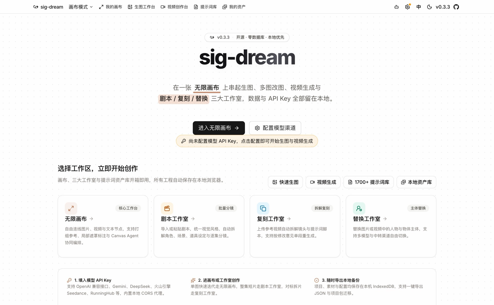
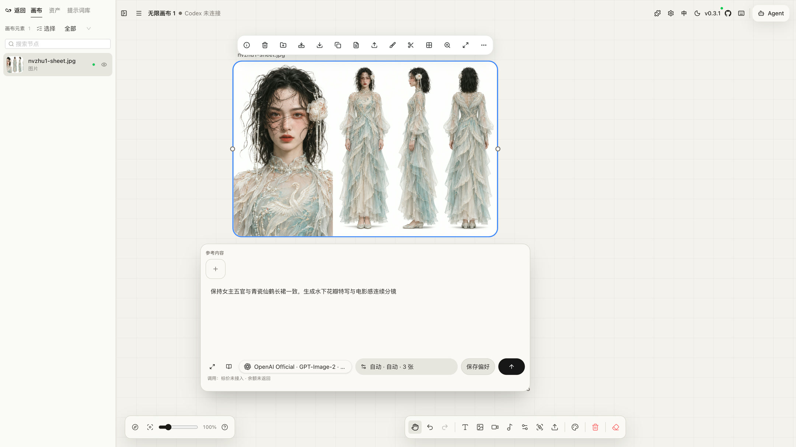
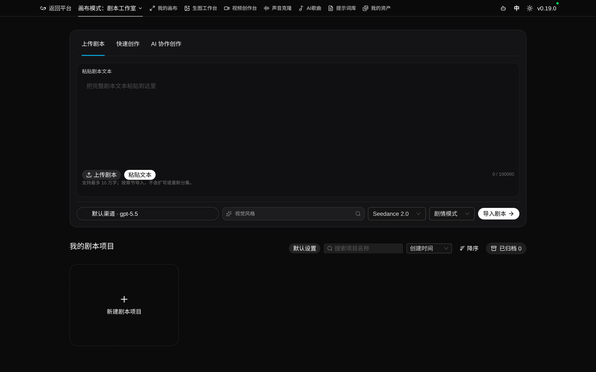

# sig-dream 使用手册

适用版本：当前仓库 `v0.3.4` 社区开源版。核对日期：2026-11-24。

本手册面向首次使用者与日常创作者，按当前源码中的界面与功能编写。不同发行包、模型渠道和客户端版本可能有差异；安装文件以 [Releases](https://github.com/ChenShuo2004/sig-dream/releases) 实际附件为准。本文不代表所有模型或 Agent 客户端均已实机验证。

## 目录

1. [先了解工作区](#workspace)
2. [安装与启动](#installation)
3. [首次配置模型](#configuration)
4. [第一个创作项目](#first-project)
5. [无限画布](#canvas)
6. [剧本工作室](#script)
7. [复刻工作室](#replication)
8. [替换工作室与声音克隆](#replacement)
9. [生图与视频工作台](#workbenches)
10. [内置技能中心与资产库](#assets)
11. [外部 Agent 接入](#agent)
12. [保存、备份与跨设备迁移](#backup)
13. [常见问题排查](#troubleshooting)
14. [可复用制作流程与交付检查](#workflow)
15. [维护者命令与功能边界](#maintenance)

<a id="workspace"></a>

## 1. 先了解工作区

sig-dream 是本地优先的 AI 图片与视频创作工具。你准备素材、编排节点和编辑项目，软件通过你配置的模型渠道发送生成请求，再在本地保存工程与媒体。

“本地优先”指工程和配置主要保存在当前浏览器或桌面客户端的本地存储中。调用模型时，提示词和所需参考素材仍会发送给所选模型服务；启用 WebDAV 后，对应同步数据会上传到你指定的服务器。

| 想完成的任务 | 使用入口 | 主要产出 |
| --- | --- | --- |
| 自由组织创意、参考图与多种媒体 | 无限画布 | 节点工程、图片、视频、音频 |
| 从创意或已有剧本开始制作 | 剧本工作室 | 剧本、角色/场景/道具设定、分集视频片段 |
| 拆解参考视频并逐段再创作 | 复刻工作室 | 原片分析、素材设定、分镜与视频片段 |
| 替换视频中的人物或声音 | 替换工作室 | 替换关键帧、镜头视频、配音、合成结果 |
| 快速生成一张图或一段视频 | 生图 / 视频工作台 | 单次生成结果与历史记录 |
| 调用创作/动效技能、复用常用素材 | 内置技能中心 / 本地资产库 | 34+ 内置 Skill 指令、角色图与媒体资产 |

浏览器使用 Hash 路由，例如 `http://127.0.0.1:3000/#/canvas`。不要把它写成 `http://127.0.0.1:3000/canvas` 来代替界面导航。



<a id="installation"></a>

## 2. 安装与启动

### 2.1 桌面客户端：适合日常创作

1. 在 [Releases](https://github.com/ChenShuo2004/sig-dream/releases) 中选择对应版本和系统的安装包。
2. macOS 按芯片选择 `mac-arm64.dmg`（Apple Silicon）或 `mac-x64.dmg`（Intel），打开后拖入「应用程序」。Windows 选择安装版 `.exe` 或便携 `.zip`；Linux 选择 `.AppImage` 或 `.deb`。
3. 打开 sig-dream，进入首页配置模型。桌面版不需要另装 Node.js，也不需要另开源码服务。
4. 首次打开若出现系统校验提示，先核对下载来源与发行附件中的 `SHA256SUMS.txt`，再按系统提供的允许打开流程处理。

桌面版通常使用 `http://127.0.0.1:28430` 作为内部服务地址。若该端口被占用，应用会提示改用其他端口；不同端口对应不同本地存储，详见[数据找回](#troubleshooting)。

### 2.2 Web 便携包：免安装依赖

前提：电脑已安装 Node.js，建议使用 Node.js 22 或更高的受支持版本。

1. 下载并解压 `sig-dream-*-web-portable.zip`，保留完整目录。
2. 按系统双击 `启动-macOS.command`、`启动-Windows.bat`，或在终端进入解压目录执行 `./start.sh`。
3. 浏览器通常会自动打开；未打开时使用启动终端打印的地址。
4. 默认端口为 `3000`，被占用时会顺延。关闭启动服务的终端会停止服务。

尽量固定使用同一个浏览器、地址与端口。`localhost` 和 `127.0.0.1` 的本地数据彼此独立。

### 2.3 源码启动：适合开发与修改

建议使用 Node.js 22+；前端构建工具对 Node.js 的小版本也有要求，旧版 Node.js 20 请先升级到兼容版本。

```bash
git clone https://github.com/ChenShuo2004/sig-dream.git
cd sig-dream
npm install
npm run dev
```

打开终端打印的地址，默认 `http://127.0.0.1:3000`。`npm run dev` 会先自动构建本地 Canvas Agent 归档。

生产模式在同一项目目录执行：

```bash
npm run build
npm run start:open
```

不要直接双击 `dist/index.html`；页面和代理需要通过本地 HTTP 服务运行。

### 2.4 Docker：适合固定机器托管

前提：已安装 Docker 与 Docker Compose，以及用于生成访问配置的 Node.js。

```bash
git clone https://github.com/ChenShuo2004/sig-dream.git
cd sig-dream
npm run access:init
docker compose up -d --build
```

访问 `http://localhost:3000`，用项目 `.env` 中的用户名和随机密码登录。生成器不会将密码打印到终端；在本机查看文件即可。已有 `.env` 时生成器会拒绝覆盖，应编辑原文件。

常用维护命令：

```bash
docker compose logs --tail=100 sig-dream
docker compose restart sig-dream
docker compose down
```

默认仅映射本机回环地址。需要远程访问时先配置 HTTPS 反向代理与访问控制，再将 `SIG_DREAM_SECURE_COOKIE` 设为 `1`。`.env` 不要提交到仓库。`/healthz` 可用于检查服务是否在线。

容器运行服务，浏览器保存本地工程。换一台电脑打开同一服务地址，不会自动出现原电脑的本地项目。

<a id="configuration"></a>

## 3. 首次配置模型

从首页「配置模型渠道」、右上角设置或 `#/config` 进入。渠道是“服务地址 + 密钥 + 模型列表”的组合；文本、图片、视频和音频可以使用不同渠道。

### 3.1 添加一个可用渠道

1. 进入模型渠道设置，点击添加渠道，或选择已有渠道编辑。
2. 填写容易识别的渠道名称，例如「我的图片渠道」。
3. 按服务方接口选择 `OpenAI` 或 `Gemini` 协议；若是已适配中转站，可先选相应预设。
4. 填入服务方提供的 Base URL 与 API Key。Base URL 应是 API 基址，不能直接填官网首页；是否包含 `/v1` 依渠道协议和预设而定，不要自行重复追加路径。
5. 在「选择模型」中添加账号实际可用的模型，核对模型 ID 和能力分类：文本 / 图片 / 视频 / 音频。
6. 保存渠道，再到偏好设置选择默认模型。进入具体工作室后还可单独选择该项目的模型。

| 准备做什么 | 至少需要什么模型 |
| --- | --- |
| 手动编辑画布、导入已有素材 | 无需模型 |
| 生成或改写剧本 | 文本模型 |
| 分析视频、识别画面 | 支持对应视觉输入的文本/多模态模型 |
| 生图、参考改图 | 支持对应生成或编辑方式的图片模型 |
| 生成分镜视频 | 支持所选参考方式的视频模型 |
| 配音、声音克隆 | 支持相应能力的音频模型或工作流渠道 |

模型列在列表里，不代表账号已有权限，也不代表支持所有比例、时长和参考输入。先用一个小任务验证，再批量操作。

### 3.2 验证配置

1. 在生图工作台选择刚配置的模型。
2. 输入简单提示词，例如「白色背景上的红色陶瓷杯，产品摄影」。
3. 选择该模型支持的尺寸，提交一张图片。
4. 确认结果可预览并能下载，再继续视频工作流。

模型请求可能由服务方计费；生成、重生成和批量任务都可能产生新费用。软件本地运行与模型服务费用是两件事。

### 3.3 代理与设置备份

- 内置服务为已适配渠道提供转发能力。遇到跨域问题时，先确认自己通过桌面版、本地服务或开发服务访问页面。
- 「本地代理」设置还提供独立代理的启动命令、地址和测试入口。仅在需要独立代理的调用路径下启用，并按面板当前命令运行；代理测试成功不代表模型密钥也有效。
- 设置顶部可导出 `infinite-canvas-config.json`，也可导入配置。该文件包含渠道密钥、WebDAV 配置与提示词来源，请作为私密文件保存。

<a id="first-project"></a>

## 4. 第一个创作项目

建议先跑通“参考图 → 改图 → 视频 → 下载”的小流程。

1. 进入无限画布，新建并命名项目，例如「角色测试 01」。
2. 拖入一张本地角色图，确认能够预览。
3. 新建图片生成节点，将角色图连接为参考，输入「保持角色外观，站在明亮的书店里」。
4. 选择支持参考改图的图片模型，生成一张图片并人工检查。
5. 新建视频生成节点，连接确认后的图片，选择支持图片参考的视频模型，填写动作和运镜要求。
6. 提交单段视频；完成后播放，检查人物、运动、声音与时长，再下载原文件。
7. 从画布菜单导出当前项目 ZIP，作为可继续编辑的工程备份。

验收标准：图片与视频均可打开、下载文件可播放、项目 ZIP 可重新导入。生成中的节点、任务 ID 或截图不代表视频已经完成。



<a id="canvas"></a>

## 5. 无限画布

### 5.1 节点与参考关系

- 从工具栏、空白处右键菜单或双击入口创建节点；可使用文本、图片、视频、音频等类型。
- 本地媒体可拖入画布，或从导入素材入口添加。
- 从节点连接点拖出连线，将上游素材作为下游生成节点的输入。最终可用的输入形式取决于节点和模型。
- 提示词输入框支持的 `@` 引用可帮助指明素材；提交前检查引用栏是否显示正确素材与顺序。
- 多选节点后可打组，便于按角色、场景或镜头整理。组内引用与多图参考仍需符合模型的输入限制。
- 图片节点可用的裁切、遮罩、放大等入口随节点状态和模型能力变化；提交前先看预览与参数。

建议结构：角色母版与场景图放在一侧，按镜头建立“提示词 → 图片 → 视频”链路，确认结果后再向后复制流程。

### 5.2 视图与快捷键

快捷键在画布区域生效；编辑输入框时以文本编辑行为为准。表中的 `Ctrl / ⌘` 分别对应 Windows/Linux 与 macOS。

| 操作 | 方式 |
| --- | --- |
| 缩放画布 | 滚轮，或画布缩放按钮 |
| 临时平移 | 按住空格后拖动，或切换平移工具 |
| 全选节点 | `Ctrl / ⌘ + A` |
| 复制 / 粘贴节点 | `Ctrl / ⌘ + C`、`Ctrl / ⌘ + V` |
| 撤销 | `Ctrl / ⌘ + Z` |
| 重做 | `Ctrl / ⌘ + Shift + Z` 或 `Ctrl / ⌘ + Y` |
| 打组 / 取消打组 | `Ctrl / ⌘ + G`、`Ctrl / ⌘ + Shift + G` |
| 删除选中节点或连线 | `Delete` 或 `Backspace` |
| 取消选择、退出当前连接等操作 | `Esc` |

### 5.3 下载与项目导出

- 下载节点媒体：获得当前图片、视频或音频文件，用于查看或后期制作。
- 导出当前项目：从画布菜单操作，获得含 `projects.json` 与已保存本地媒体的 ZIP。
- 导出多个项目：回到画布列表，选中项目后导出。
- 导入项目：在画布列表选择导入 ZIP。节点素材批量导出包与项目工程包用途不同，应使用对应入口。

项目导出会收集已存储的媒体；本地缺失的文件不会凭空补齐。对只保留远程链接的结果，应先确认媒体已保存并下载，再做迁移备份。

<a id="script"></a>

## 6. 剧本工作室

入口：`#/studio/script`。主要步骤为「原始剧本 → 素材设定 → 分集视频」。



### 6.1 准备剧本

在首页选择适合的输入模式：

- **AI 创意生成**：输入人物、冲突、背景或结局，选择模型与参数，由 AI 生成故事蓝图、大纲与剧本。
- **上传剧本**：上传 `.txt` / `.md` 或粘贴文本，支持最多 10 万字，按章节导入。导入模式保留原稿，不自动扩写或重新分集；无章节标记时先核对拆分结果。
- **剧本改写**：提供参考剧本与具体改写要求，生成新的故事蓝图和世界观。

设置中可选择剧情 / 解说模式、视觉风格、图片与视频模型，以及可用的画幅和质量。提示词模板模式与实际视频模型是不同设置：选择 Seedance 提示词模式并不会自动获得对应模型权限。

### 6.2 提取与确认素材

1. 检查原始剧本及分集内容，修正人物名称、情节和台词。
2. 点击「下一步：提取角色、场景与道具」。
3. 在「素材设定」核对角色、场景、道具及不同形象。
4. 先生成少量关键角色与场景图，确认风格、面部、服装一致后，再生成其他素材。
5. 需要留存时下载当前图或下载全部图片。

### 6.3 生成分集视频

1. 进入「分集视频」，核对分镜及提示词。
2. 检查各镜头引用的角色与场景，调整动作、声音、比例和时长。
3. 先生成一个代表镜头；验收后再生成其余片段。
4. 下载已完成片段，或通过「同步项目」进入对应画布继续组织。

日志入口可查看任务进度与报错；有停止按钮时可中止当前前端流程，但上游已接收的任务可能继续执行或计费。

当前工作室重点产出分集分镜与视频片段。需要配乐、字幕、片头片尾和完整节奏时，将媒体交给剪辑软件完成最终合成。同步到画布不等于备份工作室原始文档。

<a id="replication"></a>

## 7. 复刻工作室

入口：`#/studio/replication`。主要步骤为「上传原片 → 原片分析 → 素材设定 → 分镜与视频」。

1. 新建项目，在「上传原片」导入参考视频，等待本地预处理完成。
2. 选择能处理对应视觉输入的分析模型，点击「分析原片」。
3. 在「原片分析」检查切镜、动作、运镜、角色、台词和分段计划。若界面提示未听取原音轨，台词只依据画面字幕推测，应逐句核对。
4. 在「素材设定」准备新角色、场景或其他替换素材，确认形象后再继续。
5. 在「分镜与视频」生成分镜，逐段检查和修改提示词。
6. 先生成一段视频，再使用「生成缺少的视频」补齐。只需修正一段时，使用该段的重生成入口。
7. 完成后同步到画布，下载所需媒体，再按目标片长进行剪辑。

修改分段时长或提示词模式可能重算分段计划。已生成片段应先下载留存，再调整上游分析。分析和分镜是对参考片的解释，需要人工确认，不保证逐帧复现。

<a id="replacement"></a>

## 8. 替换工作室与声音克隆

入口：`#/studio/replacement`。新建时先区分视频人物替换与仅声音克隆。

### 8.1 视频人物替换

主要步骤为「素材设定 → 图像替换 → 视频替换 → 声音克隆 → 合成视频」。

1. 导入原片，等待素材处理和人物识别。若有失败来源，先查看来源面板处理错误。
2. 上传或生成替换角色图，将角色卡拖到目标人物框，检查每个镜头的人物绑定。
3. 选择替换范围，例如完整人物、脸部和头发、服装或当前可见部分。
4. 选择提示词模式：定位模式用字母框指认人物；常规模式用方位描述；手动模式自行编辑并按需 `@` 引用图片。
5. 在「图像替换」先生成关键帧，检查遮挡、手部、光照和背景。
6. 在「视频替换」生成镜头视频，逐段检查人物一致性和运动连续性。
7. 需要换声音时进入「声音克隆」，核对台词、说话人、参考音与音频模型/工作流配置，再逐句生成。
8. 在「合成视频」确认镜头和声音，完成合成后播放检查，再从导出菜单下载完整视频。

### 8.2 仅声音克隆

1. 新建仅声音任务，导入待处理音视频与所需参考素材。
2. 进入「声音克隆」核对台词与说话人，配置可用的音频渠道，生成配音。
3. 进入「合成音频」，将克隆结果与背景声混合。
4. 使用「合成并下载最终音频」，或在已有合成结果时下载最终音频。

具体声音模型与工作流取决于你的渠道配置。仅上传参考音不代表已具备可运行的克隆后端。

### 8.3 选择正确的导出类型

| 导出选项 | 用途 |
| --- | --- |
| 当前镜头关键帧 / 替换视频 | 下载单镜头结果 |
| 完整视频 / 最终音频 | 获取已经完成合成的成品 |
| 全部素材（ZIP） | 交接媒体给剪辑环节 |
| Premiere 工程（XML） | 交接时间线；导入后核对媒体关联和效果 |
| 项目包（可导入） | 备份替换工作室项目，之后从该工作室首页导入 |

“全部素材 ZIP”和“项目包”不是同一种备份。需要继续编辑时应选择可导入项目包；选择完整视频后仍应播放实际下载文件验收。

<a id="workbenches"></a>

## 9. 生图与视频工作台

### 生图工作台 `#/image`

1. 选择渠道与图片模型，填写提示词。
2. 参考改图时添加参考图片，核对顺序与引用；纯文生图可不传参考。
3. 设置模型支持的比例、尺寸或质量，提交生成。
4. 在结果区预览、下载，或保存到资产库供后续复用。

### 视频工作台 `#/video`

1. 选择视频模型，再确认可用输入方式：文本、首尾帧或多参考等。
2. 添加素材与提示词，核对动作、镜头、声音、比例和时长。
3. 提交后留意任务状态；长任务可能需要持续轮询上游。
4. 已持久化的远端任务在刷新后可续查，具体恢复能力取决于渠道与任务记录。遇到超时先查看历史状态，避免直接重复提交。
5. 完成后下载视频；需要衔接镜头时，可使用视频首帧、尾帧或当前帧截取功能。

不同模型的参数不通用。切换模型后重新检查时长、分辨率和参考数量，不能只更换模型名称就直接沿用原设置。

<a id="assets"></a>

## 10. 内置技能中心与资产库

### 内置技能中心 `#/skills`（兼容旧路径 `#/prompts`）

1. 内置 34 个创作与动效 Skill，涵盖 14 个视频与内容创作工作流、`anatomy` 人体解剖、`video-shotcraft` 电影分镜以及 Remotion / Motion Canvas / Manim / Three.js / Blender 等 18 大视频/动效/3D 引擎。
2. 按分类筛选或搜索技能，点击展开详情后可一键复制触发词（如 `$cs-code-video`）或完整 `SKILL.md` 规范。
3. 所有内置技能均同步落盘在 `.agents/skills/<skill-name>/SKILL.md`（桌面版、Web 便携包与 Docker 镜像均已内置），接入外部 MCP Agent 后可直接按技能名调用。

### 本地资产库 `#/assets`

- 给常用角色、场景、视频和提示词起明确名称，方便搜索和跨项目复用。
- 可从生成结果保存资产，也可按界面提供的类型入口添加。
- 导出资产 ZIP 用于备份；在另一环境从资产库导入。
- 删除资产前确认相关工程已备份，不要把资产库当作原始文件唯一保存位置。

资产包包含 `assets.json` 及可读取的本地媒体，与画布项目包、替换工作室项目包的导入入口不同。

<a id="agent"></a>

## 11. 外部 Agent 接入

外部 Agent 可以通过 MCP 读取画布状态、编排节点并执行支持的操作。面板提供多个客户端的配置格式；是否支持要以该客户端当前版本及配置能力为准。

### 11.1 同机连接

1. 启动画布桌面版或本地服务，并保持目标画布打开。
2. 进入右上角「Agent → 连接」，选择 Codex、Claude、Cursor、Grok Build、OpenCode、Antigravity、Muse Code、Pi 或通用客户端。
3. 复制面板当前生成的 MCP 命令或配置；它会引用与当前项目匹配的 Agent 归档。
4. 在目标客户端合并配置，保留其他 MCP 服务，然后刷新连接或重启客户端。
5. 确认 `infinite-canvas` 工具可见。先运行下面的只读检查，再在临时画布验证文本节点写入。

可直接复制给 Agent 的首次检查指令：

```text
请只读检查当前 sig-dream 画布连接，返回项目 ID、项目名称与节点数量。
先核对是否为我当前打开的项目。不要触发生成、重生成或其他收费任务。
```

本机 stdio 要求客户端能够运行本机进程。普通网页聊天或托管客户端不能直接启动你电脑上的 stdio MCP 服务。

### 11.2 跨机器连接

使用 Streamable HTTP：`https://<你的域名>/mcp`，并在 Authorization 请求头携带 `Bearer <Connect token>`。先完成服务端 HTTPS 和访问控制，再配置远程客户端。

Connect token、站点登录密码与模型 API Key 用途不同，不能互相替代。不要将真实 Token 写进仓库或公开截图。

详细客户端配置与验证步骤见 [Agent 接入指南](agent-connections.md)。

<a id="backup"></a>

## 12. 保存、备份与跨设备迁移

### 12.1 自动保存的范围

画布、工作室项目、历史和配置主要保存在浏览器 IndexedDB / LocalStorage；工作室项目使用单独的本地数据库。自动保存后，应等界面保存状态结束再退出。

数据按“浏览器用户配置 + 协议 + 主机名 + 端口”区分。切换浏览器、无痕模式、地址或端口，都会进入另一套存储空间。清除网站数据可能删除本地工程；更新软件前先导出重要内容。

### 12.2 按用途选择备份

| 内容 | 推荐方式 | 恢复入口 / 限制 |
| --- | --- | --- |
| 渠道、密钥、偏好、WebDAV 与提示词来源 | 设置中导出配置 JSON | 设置中导入；不含创作工程或媒体 |
| 无限画布工程与已存媒体 | 导出当前项目或选中项目 ZIP | 画布列表导入 |
| 本地资产 | 资产库导出 ZIP | 资产库导入 |
| 替换工作室原始工程 | 导出「项目包（可导入）」 | 替换工作室首页导入项目 |
| 剧本 / 复刻工作室成果 | 保存原始文本、下载媒体、同步到画布后导出 | 当前未提供同等的原始工作室项目包导入导出入口；画布备份不保留完整工作室编辑状态 |
| 交给剪辑师的媒体 | 下载原文件或全部素材 ZIP | 作为媒体导入剪辑软件，不能代替工程备份 |

要完整保留尚无项目包导出入口的工作室编辑状态，还需保留原浏览器/桌面客户端的用户数据环境；不要在迁移验收前清除旧环境。同步到画布只保存同步得到的内容。

### 12.3 WebDAV 同步

1. 打开设置 → WebDAV，填写服务器地址、用户名、密码及界面要求的路径。
2. 点击测试连接；成功后再执行同步。
3. 等待各数据域与媒体上传/下载结束，查看最终成功或失败状态。
4. 在另一设备配置同一 WebDAV 目录，再同步并抽查工程、图片和视频。

**当前实现同步四类数据：画布、本地资产、生图工作台记录、视频工作台记录。工作室原始文档和模型配置不在这四类数据中。**

同步会读取远端、合并记录并传输媒体，不能视为只上传的历史快照。重要更改前仍应单独导出 ZIP，避免两台设备同时修改同一工程后才同步。

### 12.4 推荐迁移顺序

1. 旧环境分别导出配置、画布、资产和可导出的工作室项目包；单独保存原始剧本及下载媒体。
2. 新环境导入配置；再从各模块自己的入口导入对应工程包。
3. 如果使用 WebDAV，配置完成后同步其覆盖的数据域。
4. 抽查项目数量、节点引用、图片预览和视频播放，确认能继续编辑。
5. 核对手册表中不能自动迁移的工作室编辑状态，保留旧环境后再决定是否清理。

<a id="troubleshooting"></a>

## 13. 常见问题排查

| 现象 | 优先检查 | 处理动作 |
| --- | --- | --- |
| 打不开页面 | 服务是否运行、实际监听端口 | 从启动终端复制地址；桌面版重新打开应用；Docker 查看日志与 `/healthz` |
| 提示 `dist/index.html not found` | 源码运行时尚未构建 | 在项目目录执行 `npm run build` 后重启生产服务 |
| 模型列表为空 | 渠道是否保存、是否添加了对应能力的模型 | 编辑渠道并添加模型，核对文本/图片/视频/音频分类 |
| 401 / 403 | 模型密钥、账号权限；或站点登录是否失效 | 区分模型报错与站点认证；核对渠道和账号，必要时重新登录站点 |
| 404 / 模型不存在 | Base URL、模型 ID、接口协议 | 按渠道配置检查，不重复拼接 `/v1`；改用账号确实可用的模型 |
| 429 / 余额或配额不足 | 上游额度与并发限制 | 降低并发、检查服务方余额与限额，等待后重试 |
| 跨域 / `Failed to fetch` | 网络、内置服务、代理与 HTTPS 混合内容 | 使用正确服务入口；需要独立代理时测试地址；查看渠道实际请求错误 |
| 长时间生成中 / 超时 | 任务 ID、历史记录、上游状态 | 先续查或核对远端任务，再决定是否重试，避免重复扣费 |
| 已有任务无法下载 | 远程链接失效或本地媒体缺失 | 检查历史和来源；从原服务重新取回有效文件；不要只保存临时 URL |
| 参考图没生效 | 是否连接到目标节点、素材顺序、模型参考能力 | 核对引用栏，使用支持对应参考方式的模型，先跑单张测试 |
| 视频分析台词不准确 | 是否真正听取音轨 | 查看分析提示，人工核对字幕/台词后再生成 |
| 重启后项目看似消失 | 浏览器配置、主机名、端口是否变化 | 回到原浏览器和原地址；桌面端口顺延时释放原端口再重启；勿先清缓存 |
| 导入 ZIP 失败 | ZIP 类型是否匹配入口 | 画布、资产和替换项目包分别导入各自模块，不直接改扩展名 |
| WebDAV 失败 | 服务器权限、地址、容量与网络 | 先测试连接，再查看失败数据域；保留本地数据与导出备份 |
| Agent 没看到画布 | MCP 配置、服务状态、目标项目与 Token | 保持画布打开，刷新 MCP，先用只读指令核对项目 ID |
| 更新后提示页面资源已更新 | 页面仍引用旧构建资源 | 刷新页面或重新打开应用；不要直接清除网站数据 |
| 本地存储不足 | 设置中的本地存储统计 | 导出重要工程与原文件后再清理不需要的项目，保留可恢复备份 |

提交问题时建议附上：软件版本、操作系统、桌面/源码/Docker 等运行方式、模块与操作步骤、报错原文、渠道与模型 ID、任务时间及任务 ID。隐藏 API Key、Connect token、登录密码与私密素材。

<a id="workflow"></a>

## 14. 可复用制作流程与交付检查

### 14.1 每个新项目都可复用的流程

```text
明确目标与画幅
→ 保存原始素材与剧本
→ 配置并验证模型
→ 确认角色 / 场景设定
→ 单镜头样片
→ 人工验收
→ 批量生成与逐段检查
→ 剪辑 / 配音 / 字幕 / 合成
→ 下载成品 + 导出工程 + 验证备份
```

建议本地交付目录：

```text
项目名称/
├── 01-原始素材/
├── 02-剧本与提示词/
├── 03-角色场景设定/
├── 04-分镜媒体/
├── 05-剪辑源文件/
├── 06-最终成品/
└── 07-工程备份/
```

### 14.2 可复制的任务卡

```text
项目名称：
目标观众与用途：
入口：画布 / 剧本 / 复刻 / 替换 / 独立工作台
画幅、目标时长与输出格式：
已确认的原始素材：
固定角色与视觉风格：
文本 / 图片 / 视频 / 音频渠道和模型：
首个样片范围与本次生成预算：
必须人工检查的问题：
最终媒体、可编辑工程与备份位置：
```

### 14.3 收尾检查

- [ ] 实际图片、视频、音频已下载；视频和音频可完整播放。
- [ ] 已检查人物、动作、字幕、对白、声音及镜头连续性。
- [ ] 已保留原始素材、剧本和关键提示词。
- [ ] 已按模块导出可编辑工程，标明不能保留的编辑状态。
- [ ] 已抽查导入恢复或在新环境打开关键媒体。
- [ ] 已记录版本、模型和必要参数，交接人知道如何继续。
- [ ] 配置文件中的密钥单独保存；公开交付包不包含真实凭据。
- [ ] 未完成项、失败片段和需要后期处理的内容已明确记录。

生成完成、下载完成和公开发布是不同状态。sig-dream 的本地导出不会自动发布到社交平台。

<a id="maintenance"></a>

## 15. 维护者命令与功能边界

### 15.1 常用开发命令

在仓库根目录执行；桌面运行或打包前额外安装桌面依赖。

```bash
npm run typecheck             # TypeScript 检查
npm test                      # 单元测试
npm run build                 # 构建前端 dist/
npm run start:open            # 启动生产服务并打开页面
npm run build:portable        # 构建 Web 便携包，输出 release/
npm --prefix desktop install  # 首次安装桌面依赖
npm run desktop:dev           # 构建并启动 Electron
```

需要端到端检查时可运行 `npm run test:smoke`；该流程需要可用的 Chromium / Chrome。Agent 协议、打包与公网访问检查见 [Agent 接入指南](agent-connections.md) 及根目录 [package.json](../package.json)。无需为了阅读本手册运行测试或触发模型任务。

### 15.2 社区版功能边界

本手册描述本仓库社区版。社区版以单机本地存储为主，无需 PostgreSQL 或 Redis。Docker 的站点访问登录用于保护服务，并不提供企业级的共享数据库或团队权限系统。

README 展示的企业版 NAS 素材库、团队权限审计、剪辑软件直拖及局域网 GPU 声音工作台属于单独的企业版能力，不能据此认定本仓库已包含这些后端服务。社区版界面中的某个模型或工作流入口也需要对应外部服务才能执行。

### 15.3 文档维护约定

修改模型设置、工作室步骤、数据导出或运行脚本后，同步更新本手册对应章节与顶部适用版本。新增功能说明至少写明：入口、前置配置、输入、操作、输出、失败处理和备份方式。

相关资料：[项目 README](../README.md) · [Agent 接入指南](agent-connections.md) · [功能演示目录](demos/manifest.json)
